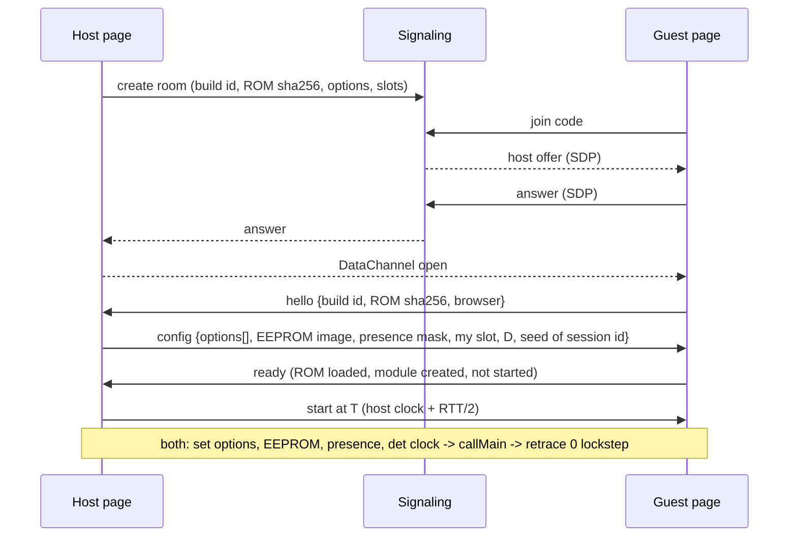
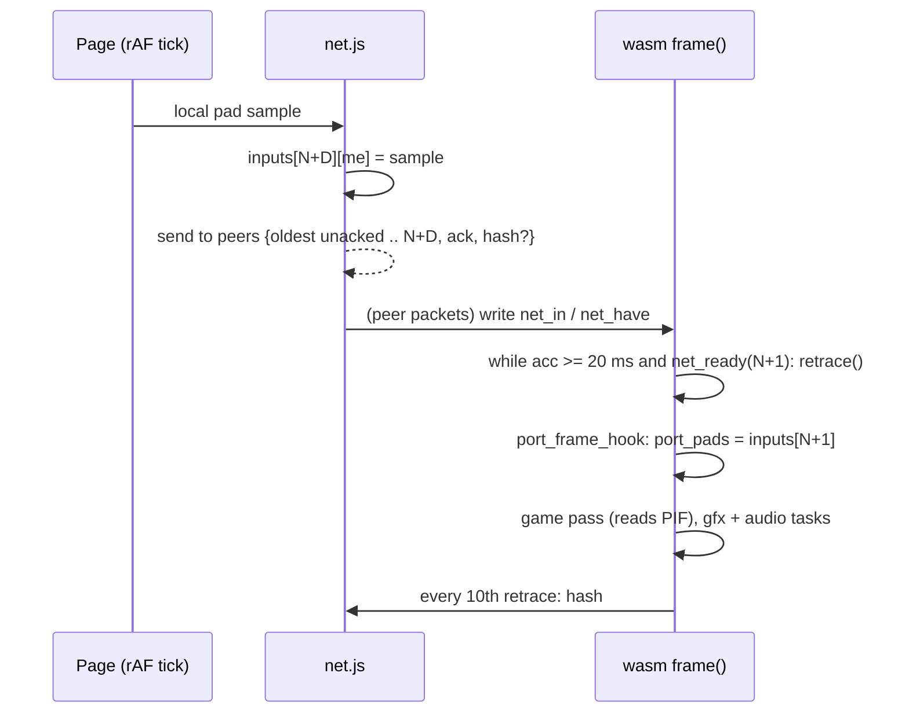

# Online multiplayer for the Conker EU web port: design (P336)

Status: design accepted (user decisions in §6); Phase 0 (determinism harness, measurements) done in P337, results in §7; Phase 1 part 1 (2-player online MVP: lockstep netcode, WebRTC with copy-paste codes, Online panel, two-peer tests) done in P338, results in §8; P339 part 2 in §9; phase 2a (3 to 4 players: mesh, host relay, star signaling) done in P344, results in §10; phase 2b (room codes: Netlify Function + Blobs) done in P345, §11. Diagram: `online_multiplayer_architecture.svg` (same folder).
Evidence comes from branch port-web at the P334 head (2026-10-27). Citations are file:line or function names.

## TL;DR (recommendation)

- **Model: deterministic input lockstep with a small input delay.** Each peer runs the same `conker.wasm` on its own ROM and boots from power-on with the same settings. Peers exchange only controller inputs: 4 bytes per player per 50 Hz retrace. The game is already close to deterministic. Under `?det=2`, recorded routes replay identically (P252, P270), and game time is counted in VI retraces, not wall time (`g_frame_ticks = g_sched_retrace_count`, init_49E0.c:308). Expected input lag is 2 to 4 retraces (40 to 80 ms) on top of the game's own lag. That is acceptable for an N64 split-screen game whose MP modes already run at 15 to 25 game fps.
- **Transport: WebRTC DataChannels** (unordered, `maxRetransmits: 0`), with every packet repeating all unacknowledged inputs. Peers form a **full mesh** (at most 6 links for 4 players), and the host relays for any pair that cannot connect. **Signaling for the MVP is copy-paste codes**, so no server is needed. Phase 2 adds room codes through a Netlify Function plus Netlify Blobs (HTTP polling; Netlify Functions cannot hold WebSockets). Public STUN is free. TURN is optional and cheap, because traffic is about 6 KB/s per link.
- **Rollback (GGPO-style) is not in the MVP.** It is feasible in principle: the whole machine is wasm linear memory, roughly 10 to 12 MB of real game state per snapshot. But the renderer and audio run inside the retrace, and resimulation cost has not been measured. It is a Phase 4 option, gated on Phase 0 measurements. **Host video streaming is ruled out:** guests would play without a ROM, it adds 100 ms or more of latency, and it needs megabits of upload per guest.
- **Session start:** every peer reboots into an "online" boot. The host dictates the build id, ROM SHA-256 (the hash only), options, the EEPROM image (2 KB of user save data, not ROM data) and the controller presence mask. From retrace 0, all peers run in lockstep. Player 1 drives the title and MP menus as on the N64, and the other players join at character select.
- **Optional and off by default**, per the feature rule. The feature lives in an "Online" panel. Without it, the page and the game behave exactly as today.
- **Status (P344):** phase 1 (2-player online, Chrome) is done: lockstep with time sync and automatic input delay,
  copy-paste codes, hidden-tab safe, desync report (§8, §9). Phase 2a (P344, §10): 2 to 4 players, full mesh with a
  host relay for pairs that cannot connect, copy-paste through the host (star), lost players stand still. Next: room
  codes (phase 2b), a real multi-machine internet test.
- **Effort:** MVP for 2 players with copy-paste signaling is about 5 to 6 sessions (Phase 0 + 1). Room codes, 4 players and robustness add 2 to 3 more. The "my view only" crop adds 1 to 2. Rollback would be 4 to 6 more.

---

## 1. Determinism audit

The question: given the same wasm, the same ROM and the same inputs per retrace, do two browsers produce bit-identical game state at every retrace?

**Good news from the architecture**
- The game is single-threaded C in wasm. Its N64 threads are Emscripten fibers on one JS thread (`emscripten_fiber_swap`, pc_sched.c `port_sched_run`), and there are no pthreads. Wasm integer arithmetic and f32/f64 arithmetic are IEEE-deterministic across engines. The build uses no `-ffast-math` and no SIMD (port/Makefile:9-22).
- libm is compiled into the wasm. The only `Math.*` calls in `conker.js` are runtime helpers (`Math.max/min/round/floor/ceil/clz32`), not game math. The 64 wasm imports are GL calls, `emscripten_get_now`, fibers, main-loop, fd and `run_script` (port_flag) (checked in the built conker.js).
- Game time is retrace-counted. `game_update_frame_timing` (game_45B80.c, was func_15019F20) derives the step from `g_frame_ticks`, which init_49E0.c:308 sets from `g_sched_retrace_count`. Slow motion, the dt history and `g_frame_count` all follow from it. The PIF read happens inside the retrace. Timers fire only at retrace (`port_vi_retrace` → `timers_poll`, pc_os.c).
- The RNG is a 64-bit LFSR in `g_random_seed` (game_DAE50.c `random_int`/`random_seed`). It is seeded with a constant (`random_seed(0x81280783)` when `g_game_mode == 2`, conker/src_eu/game/entrypoint.c:76), otherwise from its BSS value, and it lives in game memory.

**Nondeterminism sources, and how to pin each**

| # | Source | Evidence | Pin |
|---|---|---|---|
| 1 | Wall clock in `osGetTime/osGetCount` | pc_os.c `raw_time()` = `performance.now()` unless `det_mode`. Game code mixes `osGetCount()` into randomness: game_36680.c:586-594, game_357F0.c:38-70, game_3DF10.c:196-241, game_40490.c:990 | Force the det clock online. `det_now()` = retrace × 1/50 s + 1000 ticks per read (pc_os.c:381). This is deterministic as long as the sequence of reads is, and it is: reads come only from game code and `timers_poll` at fixed points |
| 2 | Scheduler wall-time budget | pc_sched.c:184: a frame returns to the browser after 40 ms (`FRAME_BUDGET_MS`), so how far the game threads got depends on CPU speed | Off under det (`!det` test at :184). Force it online |
| 3 | Audio-driven timing | `AI_LEN` (pc_os.c `__port_io_read` 0xA4500004 → `aud_out_ai_len`) reads the Web Audio ring fill, which the browser's audio callback drains | Under det, the virtual AI queue drains by retrace count (aud_out.c:139-162 `det_vq`). Force it online. The real ring only plays sound |
| 4 | Frame pacing / catch-up / frame drops | pc_sched.c `frame()`: 0 to 4 retraces per rAF tick, and a backlog above 2 periods is dropped | Harmless. Each retrace is a complete, input-indexed unit, and dropping wall time does not drop retraces. Online, the barrier `net_ready(N+1)` gates each retrace (§4). Keep det=2's wall-paced VI, not det=1's "one per tick" |
| 5 | Input sampling time | main.js `pollInput()` writes `port_pads` in wasm memory every animation frame, asynchronously (pc_pif.c:12-14, 33) | Online, the page never writes `port_pads`. `port_frame_hook` (pc_sched.c:380) copies `inputs[N][ch]` at the start of retrace N. `?padf` already proves frame-indexed input replays (pc_pif.c:40-84) |
| 6 | Tab hidden / pause | main.js:593 `visibilitychange` → `port_set_paused` stops frames (pc_sched.c `frame()`; pc_os.c `now_ms`) | Not a determinism bug, since stopped frames run no retraces, but it stalls the session. Online: broadcast "paused", or keep running on a `setTimeout` loop (a tab playing audio is throttled less). Never pause silently |
| 7 | Controller presence | `controller_init_all` (game_33660.c:35, was func_15006234) runs `osContInit` once at boot. That sets `g_cont_connected_mask`/`g_cont_count`, and pc_pif.c `osContInit` reports channel i present iff `port_pads[i][0]` | The host fixes a presence mask before `callMain`. It is identical on all peers and has one bit per human (others absent, or bots chosen in the game menu) |
| 8 | Options that change game code | port_options.h: skip intro, HUD always on, longer breath, longer tail spin, no drunk FX, full LOD, air bar, swim invert, rumble (changes PIF replies and `os_motor_init`), crosshair (spawns HUD objects), volume sliders (change sequencer state) | Host dictates the whole `port_options[]` vector. Local volume moves to a page-side master gain. Page-only input options (toggle crouch/walk/R-look, main.js:317-324) stay local: they change the input sent, not the game |
| 9 | URL test flags | `port_flag()` (pc_os.c:27-40): `?padf`, `?p205goto`, `?p240steer`, `?mallocpad`, `?warp`... | Online boot ignores them, except a whitelisted test set that is part of the session hash |
| 10 | Save data | EEPROM 2 KB loaded from IndexedDB before `callMain` (main.js:692-694, pc_pif.c:105-111). MP unlocks and settings may live there | Host sends its EEPROM image (user data, not ROM data), or every peer uses a blank one. Online EEPROM writes go to a sandbox (no `portEepDirty` persist) |
| 11 | GPU-dependent bytes in game memory | Renderer writes `glReadPixels` results back into RDRAM: offscreen shadow pass `off_writeback` (gfx_f3dex2.c:829-850, P137) and pause-screen frame `fbc_check_timg` (:975-1000, P161) | They only feed later RDP texture reads, not CPU logic (to be confirmed by a write-watch in Phase 0). Exclude these ranges from the desync hash (renderer exports them). Keep camera_read_depth_row's z-row un-written online (P335 note, gfx_f3dex2.c:902); a future z readback must never be enabled online |
| 12 | Uninitialised memory / heap layout | Fresh wasm memory is zero. Game threads run on their own fiber stacks (pc_sched.c:219 `aligned_alloc(C_STACK/A_STACK)`), so stack garbage comes only from game code. The game allocates from its own heap inside the RDRAM mirror (MEMORY.md "Heap and allocator regions") | Deterministic as long as JS does not `malloc` between boot and game-thread creation in a different way. Rule: no page-side `_malloc` during a session (ROM `_malloc` happens before boot on all peers) |
| 13 | Floats | Wasm f32/f64 are deterministic, apart from NaN sign/payload bits, which engines may produce differently | Only a problem if game code inspects NaN bits as integers. Phase 0's cross-browser hash test (Chrome vs Firefox vs Safari) settles it |
| 14 | Different builds / ROMs | — | Session refuses to start unless sha256(conker.wasm) and the normalised sha256(ROM) match |

**Conclusion:** det=2 already pins 1 to 4. Online mode = det=2 + frame-indexed inputs for 4 channels + a synced boot configuration (7 to 10) + the hash exclusions in 11. Risks 12 and 13 are low and are tested explicitly in Phase 0. Cross-browser determinism has **not** been shown yet: P252/P270 replayed routes in Chrome only.

## 2. Netcode models

| | (a) Input lockstep + delay | (b) Rollback (GGPO-style) | (c) Host-authoritative streaming |
|---|---|---|---|
| What crosses the net | inputs (about 4 B/player/retrace) + hashes | the same | host: video + audio stream; guests: inputs |
| Felt latency | D × 20 ms (D = 2 to 4) for everyone, symmetric | about 0 local; remote players' actions corrected up to RTT/2 late | host 0; guests RTT + encode/decode (100 to 200 ms) |
| Needs determinism | yes (desync = session ends) | yes, plus save/restore | no |
| CPU cost | none extra | save every retrace + resimulate up to RTT/20 ms retraces per tick | host encodes video; guests decode |
| Bandwidth | about 2 to 6 KB/s per link | the same | 2 to 5 Mbit/s per guest, host upload × 3 |
| ROM rule | each player owns and loads a ROM | the same | **broken**: guests play without a ROM; game pictures and audio streamed |
| Work | small: barrier + input ring + signaling | large (see below) | medium (`canvas.captureStream` + MediaStream), but against the project rule |

**(b) Rollback, in detail.** *Snapshot size.* Static data+bss+stack end at `__stack_pointer` = 0x113F96D0, about 19 MB above `GLOBAL_BASE` = 256 MB (parsed from conker.wasm). That region contains the 8 MB `n64_rdram` mirror, the 64 KB `n64_seg16`, game C globals, the port's PIF/timer/scheduler state, plus things that must **not** be restored: the audio ring (aud_out.c:21, 512 KB, read by the ScriptProcessor), renderer statics (≥ 5 MB of `glReadPixels` scratch at gfx_f3dex2.c:829/975, plus texture-cache tables that mirror GL objects living in JS) and test-aid buffers. On the heap are the 64 MB ROM copy (excluded) and fiber stacks (256 + 128 KB per thread). The real game state is about 10 to 12 MB.

*Cost.* A 12 MB copy takes about 1 to 3 ms on desktop and 3 to 8 ms on phones. A ring of 8 snapshots takes about 100 MB. Delta/dirty-page snapshots would be smaller, but wasm has no write barrier, so finding dirty pages needs a compare pass of the same cost.

*Resimulation.* A retrace contains the whole game pass, including display-list building (CPU), the gfx task (`osSpTaskStartGo` → `gfx_run_task`, WebGL, pc_os.c) and the audio task (`aud_run_alist`). During resimulation the gfx task must be skipped (post SP/DP events without drawing), and audio output must be discarded while its state is kept. The per-retrace CPU time with 4 players has not been measured. At an assumed 3 to 8 ms without rendering, a 100 ms RTT means rolling back about 3 retraces, so 10 to 25 ms of work in a 20 ms tick. That is fine on desktop and marginal on phones.

*Hard parts.* Restoring memory is only safe between retraces, when every fiber is suspended (it is: `frame()` runs on the scheduler context). The asyncify/fiber bookkeeping in JS is append-only, so it is fine. The renderer's C caches must be excluded or invalidated, or they will point at stale GL objects. A wrong snapshot region list shows up as rare, hard-to-debug desyncs.

**Recommendation:** (a) now. The game itself has 2 to 3 retraces of pipeline lag and MP runs at a low game fps, so 2 to 4 retraces of input delay is in the range players accept for N64 netplay (it is how emulator netplay, e.g. Mupen64Plus netplay / RetroArch "delay frames", is commonly played). Keep (b) as Phase 4, only if Phase 0 measures `retrace` without rendering at ≤ 4 ms on mid hardware and players ask for it.

## 3. Transport, signaling, topology

**DataChannel settings:** one channel per pair, `{ordered: false, maxRetransmits: 0}`. Packet layout (binary, about 40 to 60 B):

`type | first_frame u32 | count u8 | ack_frame u32 | inputs[count] (buttons u16, x s8, y s8) | [hash_frame u32, hash u32]`

Each packet carries every input from the oldest unacknowledged frame to N+D (up to K = 32). One lost packet therefore costs nothing, and only a burst longer than D stalls. A reliable ordered channel (`ordered: true`, the default) is simpler, but head-of-line blocking makes one lost packet stall for a full RTT. Use it only for control messages (lobby, config, pause, disconnect, desync report), on a second channel.

**WebSocket relay instead of WebRTC?** It works everywhere, with no NAT issues, but every input pays client→server→client and TCP head-of-line blocking. It is fine as a fallback transport behind the same `net.js` interface. It needs a real WebSocket host (not Netlify).

**Signaling options (the static Netlify site cannot hold a WebSocket):**

| Option | Infra | UX | Notes |
|---|---|---|---|
| Copy-paste codes | none | host sends a code, guest pastes and returns an answer code (chat/Discord) | Non-trickle ICE (wait for gathering), SDP compressed to about 300 to 600 base64 chars. Fine for 2; for 4 use a star (3 exchanges) and let the host forward the mesh offers over its channels |
| **Netlify Function + Netlify Blobs** | stays on Netlify; free tier | 4 to 6 letter room code | HTTP POST offer/answer under `room/<code>/<slot>`, guests poll every 1 s for a few seconds. No WebSocket needed. Rooms expire after 10 min |
| Cloudflare Worker + Durable Object | a CF account (free tier) | room code, instant | Real WebSocket; also a ready relay fallback |
| Public brokers (PeerJS cloud, MQTT, Nostr) | third party | room code | Depends on someone else's uptime and privacy |

**NAT traversal:** STUN via `stun.l.google.com:19302` and `stun.cloudflare.com:3478` (free). This works for most home NATs. Symmetric NAT and mobile CGNAT (roughly 10 to 20 % of pairs) need TURN. Options: a free tier of a hosted TURN (Cloudflare Realtime TURN, metered.ca; check current limits), or coturn on a small VPS. Traffic is tiny: about 6 KB/s per link, about 20 MB per player-hour, so cost is negligible. Short-lived TURN credentials can be minted by a Netlify Function (HMAC of a secret kept in Netlify env vars).

**Topology:** for 2 to 4 peers, use a **mesh**: each peer sends its own input to every other peer, and latency is that of the worst pair. Fallback: if a pair fails ICE, the host relays that pair's inputs (+1 hop for that pair only). A pure star (all through the host) is simpler to signal but adds a hop for every guest-to-guest pair. Use it only if copy-paste signaling is used for 3 to 4 players.

## 4. Integration points in the port

**New C (port side only; game C unchanged):**
- `port/ultra/pc_net.c`: an input ring `net_in[256][4]` (frame mod 256) plus `net_have[256]` bitmasks in wasm memory, filled by JS. It exports `port_net_ptr()`, `port_net_enable(mask_present, local_ch, delay)` and `port_net_frame()` (the last retrace run).
- **Frame barrier:** pc_sched.c `frame()` changes from `while (acc >= per && n < VI_MAX_STEPS)` to `... && (!net_on || net_ready(port_frame_count + 1))`. If inputs are missing, the accumulator is clamped and nothing runs, so the game just pauses for that tick. `port_video_frame` still presents the last frame. The peer with the larger frame advantage nudges its `per` up by 1 % (GGPO-style time sync) so stalls stay rare.
- **Input application:** `port_frame_hook` (pc_sched.c:51, :380) = `net_apply()`. It copies `net_in[N][ch]` into `port_pads[ch][1..3]` for every present channel, before `port_vi_retrace`/`port_sched_run`. Then the game's `cont_read_frame` → `osContStartReadData` → `pif_run` (pc_pif.c:250-265) delivers it unchanged. `padf_apply()` must not run online.
- **Forced determinism:** `port_flag("det")` is read lazily in 4 places (pc_os.c:390, pc_sched.c:179, :406, aud_out.c:152). Add `port_net_force_det()`, set before `callMain`, so those read 2 when online.
- **Session config before boot:** the options vector via `port_set_option` (existing), the EEPROM via `port_eeprom_ptr` (existing), presence via `port_pads[i][0]` (existing), and the sandboxed EEPROM via a flag that suppresses `__port_eep_dirty`.
- **Start point:** MVP = power-on in lockstep, with "Skip intro" forced on so the title appears quickly. Player 1 navigates to Multi → mode → characters, and the other players press A at character select, exactly as on an N64. Later: an `?warp`-style direct start into an MP mode (`g_level_start_session_mode`, `g_level_start_player_mask`, `g_level_load_id`, game/entrypoint.c:79). This needs mapping the MP menu's writes and is not in the MVP.
- **Desync detection:** `port_net_hash()` every 10 retraces, hashing `g_random_seed`, `g_frame_count`, then xxHash32 over `n64_rdram` in 64 KB blocks (minus renderer-written ranges), `n64_seg16`, and the port's PIF/timer state. Cost is about 1 ms per 8 MB. Hashes travel in the input packets. On a mismatch, both peers exchange their 128 block hashes, report frame + blocks + addresses (names via symbols.tsv), and end the session.
- **Pause:** the in-game pause (START) is just input, so it is deterministic and free. A page pause or hidden tab sends a control message "P2 paused", and every peer shows an overlay while the barrier stalls naturally.
- **Disconnect:** after 10 s without packets, the remaining peers agree on the last frame F they hold for the lost player (max of what anyone has, forwarded). From F+1 that channel gets neutral input, and the session continues, or the host ends it (host's choice in the lobby). A lost host ends the session in the MVP.
- **Local view (optional, presentation only):** split-screen layouts are fixed per player count (2 players: top/bottom; 3 to 4: quadrants). The renderer can blit the local player's viewport rectangle to the full canvas in `port_video_frame` (`glBlitFramebuffer` is already imported). Letterbox it to keep its aspect, or stretch it (a toggle). This changes nothing in game state, so it is safe. Making the game *draw* only one view is **not** safe, because rendering code also does LOD and visibility, which feed game logic.

## 5. Options and feature rules

- The new **"Online" panel** in the page (next to Options) is hidden behind an Options toggle "Online multiplayer (experimental)", default **off**. With it off, `net.js` is not even loaded, and `frame()`/`port_frame_hook` take today's path (`net_on == 0`). This is testable by conker.wasm md5 plus the existing holdl/warp regressions.
- In a session, the host's Options panel values are applied and the guests' panels are greyed out. Local-only settings remain: key/pad bindings, toggle latches, master volume (a new page gain node instead of the game sliders), and "my view only".
- One commit per feature, per the project rule: (1) det force + net ring + barrier (C), (2) net.js + copy-paste signaling + Online panel, (3) desync hash, (4) room codes, (5) view crop, and so on.

## 6. Risks, open questions, effort, tests

**Risks**
1. **Cross-browser float/NaN differences** (low). Caught by Phase 0 hash trails; if found, fix the specific game function.
2. **Hidden state outside the hashed regions** that diverges, e.g. a port-side cache used by game logic. Phase 0 compares *all* non-excluded memory between two runs to find it.
3. **The game's own MP menu flow differs with remote players** (e.g. it expects the controller to be present at boot). That is handled by the presence mask. The "Press A to join" flow is the same as a local pad.
4. **Background-tab throttling** stalls everyone. Mitigated by the overlay and the setTimeout loop; worst case, a paused session.
5. **Browser performance gap:** lockstep runs at the speed of the slowest peer. A phone that cannot hold 50 Hz in 4-player split screen slows the whole session.
6. **Audio during stalls:** the ring underruns into short silences (no crackle, since the ring drops cleanly). Acceptable.
7. **Unconverted or stubbed MP code paths** (e.g. P224's MP stubs, now all C) may hide port bugs that are themselves nondeterministic, such as reads of uninitialised null-zone memory. Phase 0 surfaces them as divergences.

**Decisions (user, 2026-10-27)**
1. Input delay of 40 to 80 ms is acceptable. Lockstep it is; rollback stays optional.
2. Copy-paste connection codes for the first version.
3. No TURN: accept that some pairs cannot connect.
4. Power-on lockstep, Player 1 drives the menus.
5. The session uses the host's EEPROM (unlocks shared).
6. A disconnected player stays in the game standing still (neutral input); the session continues.
7. "My view only" is an option (Online panel), not forced.
8. Spectators: not now.

**Open questions for the user** (answered above)
1. Is input delay (40 to 80 ms) acceptable for the MVP, with rollback only later or never?
2. Signaling: is copy-paste codes OK for the first version? For room codes, Netlify Functions + Blobs (stays on Netlify) or a Cloudflare Worker (instant, real WebSocket, a second account)?
3. TURN: pay or self-host one, or accept that roughly 10 to 20 % of pairs cannot connect (they could fall back to the host relay only if the host itself is reachable)?
4. Session start: power-on lockstep (Player 1 drives the menus, about 10 s of title) or a direct MP warp later?
5. Save data: should the session use the host's EEPROM (unlocks shared) or a blank save?
6. Disconnect policy: end the session, or continue with the lost player idle or as a bot?
7. Is "my view only" (crop) wanted for 2-player top/bottom, given its very wide aspect?
8. Should spectators (read-only peers receiving inputs) be in scope? They are cheap with lockstep.

**Effort (sessions of about 150 tool calls)**

| Phase | Content | Sessions |
|---|---|---|
| 0 | Determinism harness: `?padf` for channels 0 to 3; `port_net_hash` + per-retrace hash log; two runs in one Chrome, Chrome vs Firefox/Safari; node dual-instance test; write-watch on renderer writebacks; measure retrace ms with and without rendering (rollback gate); snapshot-size measurement | 1 to 2 |
| 1 (MVP) | pc_net.c ring + barrier + forced det + presence/options/EEPROM sync; net.js with WebRTC mesh for 2 players; copy-paste signaling; Online panel; desync report | 3 to 4 |
| 2 | Room codes (Netlify Function + Blobs), 3 to 4 players, host relay fallback, TURN credentials, adaptive D + time sync, disconnect handling, stall overlay | 2 to 3 |
| 3 | "My view only" crop; MP direct-start warp; spectators | 1 to 2 |
| 4 (optional) | Rollback: region registry, renderer/audio suppression in resimulation, snapshot ring | 4 to 6 |
| — | Reconnect/late join by deterministic fast-forward of the input log from retrace 0 (no state transfer) | 2 |

**Test strategy**
- **Offline determinism first:** one browser, the same 4-channel `?padf` MP script run twice, gives identical per-retrace hash logs. Then the same script in Chrome and Firefox (and Safari if available) gives identical logs. Then a node run (`PORT_DET`, node_run.js) gives the same.
- **Two peers on one machine:** one headless Chrome (muted, `--mute-audio`, `?mute=1`, one Chrome at a time per the project rules) with **two tabs** connected over WebRTC on localhost (host candidates, no STUN). Each tab gets its own channel's `?padf`. Pass criteria: hash trails identical between the tabs and identical to the offline 4-channel run of the merged script.
- **Network emulation in-page:** a `net.js` shim with `?netsim=lat:80,jit:20,loss:5` delays, reorders and drops DataChannel messages (no root-level tc/dnctl needed). Check that there are no desyncs, that stalls stay below a threshold at D = 3 with 80 ms latency, and that disconnect handling works.
- **CI-friendly:** a node test with two module instances in one process exchanging inputs through an in-memory lossy queue. It runs fast with no browser.
- **Regression:** with the feature off, conker.wasm behaviour is unchanged (holdl.sh, warp.sh), and check.sh is GREEN.

## 7. Phase 0 results (P337, 2026-10-27)

Harness (all behind test flags; without them the game is unchanged: hold-L 5789 / 0x29 at 5795, check.sh GREEN):
- `?netdet=1` (port/ultra/pc_net.c; phase 1 calls `port_net_force_det()` instead): det clock, no frame budget, virtual AI
  queue (`port_flag("det")` = 2), every other flag reads 0 unless whitelisted, page writes no pad state, default options
  vector sent once, blank EEPROM never persisted, game threads' fiber stacks in fixed static slots.
- `?padf` / `?padf1..3` frame scripts for the 4 channels, `?padmask=HEX` presence (pc_pif.c).
- `?nethash=F` per-retrace hash (port/ultra/pc_nethash.c): H = static region minus the port-only ranges in
  `conker_netx.txt` (port/tools/net_regions.py, from the link map; reasons listed there) minus GPU read-back ranges;
  S = live fiber stacks. `?nethashstop=N` + dump, `tools/port/nethash_diff.py` names the divergent bytes.
- `?netprof`, `?netsnap`, `?netnogfx`, `?netgpujunk`; runners `tools/port/scripts/netrun.sh` (Chrome) and `netnode.sh`.
- Session used: power-on, Player 1 drives title -> MULTI -> War -> Total War, pads 2..4 press Start on the join page
  (~retrace 5750), 4-player split screen from retrace 6545, then ~60 s with all 4 pads moving, jumping, attacking
  (`tools/port/scripts/netmp_pads.py`). Logs: port_work/p337 (not committed).

**Proven identical (H and S, every retrace):**

| Runs (same build, same Chrome, one at a time) | Retraces compared |
|---|---|
| A vs B: two plain runs (P337 commit 2 build) | 10716 |
| A vs C: C with 4x CDP CPU throttling and a 7 ms setTimeout main loop (other ticks / catch-up pattern) | 10722 |
| A3 vs D3: D3 saves and restores a full snapshot every retrace (`?netsnap`) | 9975 |
| A3 vs F3: F3 with 6x CPU throttling, 7 ms loop, and the GPU read-back bytes replaced by 0x5A (`?netgpujunk`) | 9975 |

The last row shows that game logic never reads the renderer's RDRAM write-backs as data (only one range was written in
this session: the 4 KB image at N64 0x800E2480, retrace 745, during the boot sequence). Note: the game kept 50 retraces/s
even at 6x throttling on this Mac mini, so a backlog drop never happened in these runs; the retrace content does not
depend on the tick pattern by construction (each retrace is a complete, input-indexed unit).

**Without rendering (`?netnogfx`, gfx task skipped):** static game memory equals the rendered run except the GPU
read-back range itself (not written) and one renderer flag cache (now excluded); the fiber stacks differ only in dead
slots below the stack pointers (the renderer runs on the game's scheduler thread and leaves different garbage there).
So resimulation can skip rendering. For a rollback snapshot the stacks must be saved, but the S hash should then only
cover the live part of each stack (phase 4).

**Divergences found:**
1. Fixed (commit 85a21fd5): fiber stacks came from the heap, whose layout depends on earlier runtime / renderer
   allocations (Chrome vs node: 0xEB0 apart). Their addresses end up in game memory, so peers with a different browser /
   GPU would have disagreed on pointer values from retrace 1. Under `?netdet` they are static slots now. Also excluded:
   dlmalloc `sbrk_val` (heap top).
2. Open, node only: Chrome vs node (node_run.js in the emsdk container) still differ from retrace 6 in 6 two-byte words
   of the audio heap arena (N64 8007BF88, 8007DAA0, 8007DAE8, 8007F600, 8007F648, 80081144, stride ~0x1B18: Chrome 0,
   node 0x5604 in the low half of the word). Chrome with `?nogl=1` matches Chrome with WebGL there, so it is not the
   renderer; the remaining node difference is the missing AudioContext (aud_out_open returns -1) or another
   node/browser runtime difference, not yet located. Phase 1 peers are browsers, so this does not block phase 1, but a
   node CI peer (design §6 test strategy) needs it found first: write-watch those words from retrace 4 to 6.
3. Not tested: Firefox (not installed) and Safari (installed, but headless automation needs `safaridriver --enable`,
   a user action). Cross-engine float/NaN determinism (risk 13) is therefore still unproven; the first phase 1 two-tab
   test should include a Firefox or Safari peer.

**Measurements** (Mac mini M-series, headless Chrome, ANGLE Metal, 4-player Total War split screen, retraces
6750..10500; Chrome's timer resolution is 0.1 ms):

| Quantity | Value |
|---|---|
| Retrace cost with rendering | 1.4 to 1.9 ms mean (p50 0.2, p95 5.7 to 9.5, max 13.4) |
| of which gfx task (display list interpreter + WebGL calls) | 1.2 to 1.7 ms mean |
| of which audio task | 0.07 ms mean |
| of which game threads + scheduler | 0.13 ms mean |
| Retrace cost without rendering (`?netnogfx`) | 0.52 ms mean (p95 1.5, max 1.7) |
| Hash of all hashed bytes (static 9.5 MB + stacks 2.3 MB) | 3.4 to 3.7 ms per hash (once per 10 retraces in phase 1: fine) |
| Static region | 19.4 MB without the stack slots (31 MB with them; 7934 pages of 4 KB), of which 9.5 MB hashed |
| wasm memory | INITIAL_MEMORY 352 MB (256 MB address space below GLOBAL_BASE unused, ROM copy 64 MB on the heap) |
| Rollback snapshot (hashed static bytes + live fiber stacks) | 11.4 MB |
| Bytes changed per retrace | 13.5 to 14 KB mean (max 29 KB) in 38 pages mean (max 85 of 7934) |
| Full snapshot save / restore (memcpy) | 0.28 to 0.38 ms / 0.30 to 0.41 ms mean (max 1.2 ms each) |

**Go / no-go:**
- Phase 1 (lockstep MVP): **GO.** Same-browser determinism holds for a full 4-player MP session from power-on,
  including different wall speeds, main-loop pacing and snapshot save/restore. Phase 1 should reuse `?netdet` as the
  online boot, the 4-channel input path, the presence mask and the hash (every 10 retraces; per 64 KB block hashes for
  the desync report, as designed). First phase 1 test: one Chrome tab + one Firefox/Safari tab.
- Rollback gate (retrace without rendering <= 4 ms on mid hardware): **passed on this desktop** (0.5 ms mean,
  1.7 ms max; snapshot 11.4 MB, about 0.4 ms each way, only ~14 KB / 38 pages dirty per retrace, so a dirty-page delta
  ring is cheap). A 100 ms RTT rollback of 3 to 5 retraces would cost about 3 to 5 ms per tick here. Still to measure:
  a phone / low-end laptop before committing to phase 4.

## 8. Phase 1 part 1 results (P338, 2026-10-27)

**What exists** (commits 20c14399, 156d900b, 88c794a3 and the item 4 commit):
- Game side (port/ultra/pc_net.c §4, pc_sched.c `frame()`, pc_pif.c): input ring 256 frames x 4 channels with a frame
  tag per slot, `port_net_session(mask, local, D, K)` before callMain (forces online determinism, presence mask),
  local input for frame N + D sampled at the start of retrace N (from the page's local pad, or the ?padf script under
  `?netscript=1`), frames 1..D neutral, the controller read takes frame N's inputs from the ring, the frame barrier
  (`port_net_ready`), `port_net_drop(ch, F)` (a lost player is neutral from F), hash ring (H / S folded to 32 bits)
  every K = 10 retraces, `port_net_background` (timer main loop while the tab is hidden). The ring lives in pc_net.o,
  outside the hashed state.
- Page side (port/web/net.js, loaded only for a session): RTCPeerConnection, public STUN only; negotiated DataChannels
  'ctl' (reliable) and 'in' (unordered, maxRetransmits 0); copy-paste codes `CK1.` + base64url(deflate-raw(SDP after
  ICE gathering)), about 770 characters; hello with build id (SHA-256 of conker.wasm) and ROM SHA-256; host config
  (channels, D, K, game options, EEPROM image); input packets repeating all unacknowledged inputs with an ack and the
  newest hash; ping every second; hash comparison (desync event with retrace and both hashes); lost peer after 5 s
  without data / channel closed / ICE failed -> neutral controller, the game goes on. `?netsim=lat:MS,jit:MS,loss:PCT`.
  Loopback test peer `?netloop=1` (one page).
- Online panel behind the option "Online multiplayer (experimental)" (default off): Host / Join, the two codes with
  Copy, input delay field (host), status, retrace / ping / stall line, "waiting for the other player…" over the
  picture, desync box, Leave. PLAYING.md "Online (experimental)".
- Tests: tools/port/scripts/netpair.sh (two windows in one muted headless Chrome; `UI=1` clicks the panel; NETSIM_*,
  NETD, GUEST_LEAVE, SHOTS), netrun.sh `?netloop` runs, nethash_diff.py.

**Results** (2-player Total War from power-on, netmp_pads.py 7000 20: P1 drives the menus, P2 joins, both move;
H = hashed static memory, S = live fiber stacks, compared every retrace from the `?nethash=1` logs of both pages):

| Run | Retraces identical (H and S, host vs guest) | Stalled ticks host / guest | Game speed | Notes |
|---|---|---|---|---|
| WebRTC loopback, no netsim, D 3 | 9937 | 3 / 3 | 100 % | RTT ~1 ms, ~10.4k packets each way, in-band hash check to 9930 |
| Same through the panel's buttons (UI=1) | 8448 | 3 / 9 | 100 % | |
| netsim 40 ms + 0..20 jitter + 5 % loss both ways, D 3, guest leaves at the end | 6801 (until the leave) | 5278 / 5281 | ~79 % | RTT ~112 ms; host goes on alone with controller 2 neutral (7477 retraces, no trap) |
| same netsim, D 5 | 8432 | 271 / 21 | ~99 % | RTT ~110 ms |
| asymmetric 80+0..40 / 20+0..10 ms, 15 % loss, D 3 | 3867 | 4625 / 4607 | ~64 % | RTT ~135 ms, ~650 dropped packets per side |

Against the offline reference (one page, `?netdet`, the same 2 pad scripts as `?padf`/`?padf1`, `?padmask=3`), the
online host's static memory H is identical at all 6801 retraces before the leave (S differs only in dead stack bytes:
the `?padf` path logs on the game thread's stack, the ring path does not; two online / loopback sessions are identical
in S too). The 4-pad loopback session (`?netloop`, 30 ms + 5 % loss, 4252 stalled ticks) matched the 4-pad offline run
in H for all 8114 retraces. No desync was ever reported.

**Findings / left for part 2:**
1. Speed under latency: with one-way latency near D x 20 ms the game slows (79 % at 40 to 60 ms, D 3). Causes: no time
   sync (after a stall the backlog is clamped, so the stalled peer stays behind and the other one waits next), inputs
   leave on a 10 ms pump instead of right after the tick, and retraces only run on animation frames. D 5 removes the
   stalls at the cost of 100 ms input lag. Tried and reverted: keeping 6 periods of backlog online so a peer catches up
   after a stall: worse (73 % speed in the same netsim; the bursts use up the D margin). Part 2: frame-advantage time
   sync (design §4: the peer that is ahead slows its period by about 1 %), send after every tick, then maybe an
   automatic D from the measured ping.
2. Not tested: two real machines over the internet (NAT / STUN path), a hidden tab during a session
   (`port_net_background`), a Firefox / Safari peer (cross-engine floats; this session used Chrome only, as briefed), a
   real desync report (none happened; the per-block hash exchange of §4 is not built).
3. Disconnect: each side drops the other from the first frame it does not hold; with 2 players that is all that is
   needed. With 3 to 4 players the remaining peers must agree on F (phase 2).
4. The session only starts before the game: a running game must reload first (the panel says so).

## 9. Phase 1 part 2 results (P339, 2026-10-27)

**Status:** phase 1 (2-player online, copy-paste codes, Chrome only) is feature-complete. Still untested: two real
machines over the internet (NAT / STUN path); a Firefox / Safari peer is out of scope (user decision: Chrome only).

**What changed** (commits ff8ccdce, 9ac954a0, 6facf7f1):
- Why P338 slowed at one-way latency near D x 20 ms: retraces ran only on requestAnimationFrame. A stalled peer
  checked again one display frame (16.7 ms) later, so its next input sample went out late and the other peer stalled
  next (ping-pong). Fixes: the local input for N + D is sent the moment it is sampled (start of retrace N, before the
  retrace runs); a session's main loop is a 4 ms timer (250 fps setTimeout from the first tick); a packet that brings
  the input a stalled game waits for runs the tick at once (pc_sched.c port_net_kick); every packet goes out a second
  time ~8 ms later, keep-alive every 30 ms.
- Time sync (GGPO-style frame advantage): packets carry the sender's retrace and its input margin (frames of the
  other player's input held beyond the retrace run, ~0.5 s average). Every 250 ms the peer whose margin is smaller by
  more than 0.3 frames (it runs ahead) asks pc_net.c port_net_slow for about half the difference: frame() takes that
  wall time out of its 50 Hz backlog, at most 8 % of the elapsed time. The faster peer never speeds up. In every test
  below the margins stayed balanced, so the slow-down was never needed after the send / tick fixes: it is a guard,
  untested under a real clock drift.
- Automatic input delay: the host pings the guest 12 times over 'ctl' before the session (under ?netsim with the same
  latency / jitter), D = clamp(ceil((median RTT / 2 + (p90 - median) / 2) / 20 ms) + 1, 2, 8); the panel has an
  "automatic" checkbox (default on) next to the manual field; both panels show "input delay N ms (auto)".
- Hidden / covered page: Chrome throttles a hidden page's timers to ~1-2 wake-ups per second even with WebRTC. While
  hidden, a dedicated Worker posts a tick every 4 ms (net.js N.background). Also fixed: a covered window never got
  the first animation frame that started the main loop, and a hidden-page pause set before the session stuck.
- Desync report: per-page hashes (4 KB pages + one per thread stack) are kept for the last 16 hash points; after a
  desync the peers swap the vector over 'ctl' and both log / show the first differing page with the symbols in it
  (conker_netsyms.txt from `net_regions.py --syms`). It names the page, not the byte.

**Results** (netpair.sh: 2-player Total War from power-on in two windows of one headless Chrome; speed = retraces per
second / 50 from 20 s to the end; "waits" = retraces that had to wait for input; H and S compared every retrace):

| netsim | D | Before (P338) | After (P339) | Retraces identical |
|---|---|---|---|---|
| none | 3 | 100 % | 100 %, 0 waits | 7442 |
| 40+0..20 ms, 5 % loss both ways | 3 | 79.2 % | 99.6 % (~40 % of retraces wait 6.5 ms mean, absorbed by the backlog) | 8397 |
| 80+0..40 / 20+0..10 ms, 15 % loss | 3 | 65.7 % | 87.5 % (RTT ~135 ms > the 120 ms a D 3 window allows) | 5199 |
| none | auto -> 2 (ping 0.8 ms) | | 100 %, 0 waits | 4911 |
| 15+0..5 ms, 1 % loss | auto -> 3 (ping 36 ms) | | 100 %, 0 waits | 4922 |
| 40+0..20 ms, 5 % loss | auto -> 4 (ping 94 ms) | | 100 %, 19 / 2 waits | 4914 |
| 80+0..40 / 20+0..10 ms, 15 % loss | auto -> 5 (ping 134 ms) | | 100 %, 5 / 10 waits | 4909 |
| none, normal background throttling, guest page covered from load and minimised 41..71 s | auto -> 2 | game never started (guest stuck at retrace 0) | 100 %, 0 waits | 5467 |
| guest flips one byte (var70059904, N64 800B0CF4) at retrace 3000 | auto | | both panels: "Desync at retrace 3000" + hashes; report: page 6048 = N64 800B0000..800B0FFF, 1 page, no stack | until 3000 |

**Left for later phases:** a real two-machine internet test; byte-level desync location (finer hashes of the
differing page, or a memory dump exchange); room codes / 3-4 players (phase 2); the node CI peer (§7 divergence 2).

## 10. Phase 2a results: 3 to 4 players (P344, 2026-10-28)

**What changed** (commits dd7c6c05, d70a52c1, d223e7e2, 00a3f949, 37283179; conker.wasm unchanged, the game side
`pc_net.c` was 4-channel since P338: ring 256 x 4, barrier over the presence mask, per-channel `port_net_drop`):
- **Slots.** The host is player 1 (channel 0). Each offer it makes names one guest slot (players 2..4) and the answer
  carries it back; the presence mask is the set of joined slots when the host presses Start (gaps allowed).
- **Signaling interface.** `N.signal` = `offer(ch)` (host) / `answer(offerPayload)` (guest) / `accept(answerPayload)`
  (host) on plain payloads `{t: 'o'|'a', ch, sdp}`. The copy-paste codes (`CK1.` deflate + base64url, ~780 / ~660
  characters) only wrap those payloads (`N.host`, `N.invite`, `N.join`, `N.accept`). A room-code signaler (phase 2b)
  carries the same payloads through a server and calls the same three functions; nothing else depends on it.
- **Star for the rest.** After a guest's link to the host is open, everything goes over the host's reliable 'ctl'
  channels: hello (build id + ROM SHA-256 checked by the host for every guest), `N.start` -> `mesh` {roster}; each guest
  offers to every higher-numbered guest and the host forwards offers / answers (`fwd`); each guest waits up to 8 s for
  its direct links, pings every other guest (12 round trips, direct or relayed) and reports `meshdone` {links, pings};
  the host pings every guest, picks D from the slowest pair, sends each guest its `config` (channel, mask, roster,
  routes, D, options, EEPROM). The user only exchanges codes with the host.
- **Mesh + host relay.** One RTCPeerConnection per pair. Input packets are made per receiver (ack, first frame and
  the time-sync margin differ) and go directly, or, for a guest pair without a direct link, as `u8 4 | u8 receiver |
  packet` to the host, which passes the inner packet on. Routing is per packet (direct when that link's 'in' channel
  is open), so a mesh link that dies later falls back to the relay by itself. Pings carry the sender channel.
- **Time sync, N players.** Each packet carries the sender's margin of the receiver's input; a peer slows down by half
  the largest (theirs - mine) over all players (P339 rule per pair). Hashes are compared with every player; the
  desync report (page vectors) is exchanged per pair and names the other player.
- **Lost player, N players (decision 6).** The coordinator = the lowest channel among the players that are not lost
  or silent (the host while it is there). It asks every remaining player for the lost player's inputs it holds
  (`lost` -> `held` {first, top, inputs}, 2.5 s timeout), takes F = 1 + the newest frame anyone holds, and sends
  `drop` {neutralFrom: F, inputs up to F - 1}; every remaining player fills the same inputs and calls
  `port_net_drop(ch, F)`. A host loses a guest when its link closes or is silent for 5 s; a guest-guest link closing
  is not a loss (relay). If the host leaves, player 2 coordinates (over the mesh; relayed pairs then break).
- **Panel.** Host / Join (players 2 to 4); the host gets one box per invited player (code, answer, Connect, state:
  invited / connecting / joined · ping / left / could not connect, "through player 1 with player N"), "Invite another
  player", "Start the game (N players)" (hidden once started); in a session every panel shows "you are player N", each
  other player's ping (relayed pairs marked), and the overlay names the players the game waits for.
- **Tests.** `tools/port/scripts/netgroup.js` (was netpair.js) runs 2 to 4 windows in one headless Chrome;
  `netpair.sh` gained `PLAYERS`, `NETSIM_GUEST3/4`, `NETFAIL=A-B` (`?netfailto`: ICE candidates removed from both SDPs
  of that pair, so it must relay), `LEAVE=NAME`; `netmp_bunker.sh` joins pads 3 and 4 (Start at 5320 / 5340) and has
  `NET_BUNKER_PLAY=SECS` (all pads play from retrace 6100).

**Results** (real MULTI menu route into Bunker Deathmatch, gameplay from retrace 5947; H and S compared every retrace,
host vs every guest; speed = retraces / s / 50 from 20 s to the end; logs and screenshots in port_work/p344, not
committed):

| Run | Players / netsim / relay | D (auto) | Speed | Retraces identical | Notes |
|---|---|---|---|---|---|
| b3a | 3, none | 2 | 100 % | 7928 | 3-way split screen, guest3_150s.png |
| b3relay | 3, P2 40+0..20 ms 5 %, P3 20+0..10 2 %, P2-P3 relayed | 4 (82 ms) | 100 % | 9941 / 10687 | P2 leaves at the end: host + P3 drop it from 9941, stay identical |
| b4relay | 4, P2 30+0..10 3 %, P4 20+0..10 2 %, P3-P4 relayed | 3 (65 ms) | 100 % | 9907 | host relayed 39722 packets; guest4_190s.png 4-way split |
| b4ui | 4 through the panel buttons, netsim on all four, P3-P4 relayed | 3 (68 ms) | 99.6 % | 13173 (7200 in Bunker) | P4 leaves: everyone drops it from 12426; host_240s.png panel with slots / relay |
| b4final (final code) | 4, netsim on all four, P2-P4 relayed | 3 (69 ms) | 98.9 % | 8812 | ~5 s of waits over 160 s (relayed pair 68 ms RTT at D 3) |
| quick4 (final code) | 4, none | 2 | 100 % | 1864 | start (mesh + pings) 1.05 s |
| hostleave4 | 4, P2 20+0..10 3 %, P4 30+0..10 2 % | 3 | 99.9 % | 3893, then guests 4640 | host leaves: P2 coordinates, P2..P4 drop P1 from 3894, identical among themselves |
| ui3leave | 3 through the panel, host 15+0..5 1 % | 2 | 100 % | 5241 | P3 leaves (found the drop-frame bug fixed in d223e7e2) |
| pair2ui (regression) | 2 through the panel, 40+0..20 5 % both | 4 | 100 % | 8428 | Total War |
| bunker2demo (regression) | 2, NET_BUNKER_DEMO=1 | 2 | 100 % | 7458 | player 2 has the weapon, guest_140s.png |

No desync in any run, no trap; hold-L 5789 / 0x29 at 5795; check.sh GREEN.

**Left:** room codes (phase 2b: a signaler on Netlify Functions + Blobs carrying the same payloads); a real
multi-machine internet test (all runs above are one machine, `?netsim` latency); when the host leaves, relayed guest
pairs lose each other (they are then dropped after 5 s); the leaver's own game diverges from the frame it did not send
(expected, it is out of the session); a late joiner / reconnect is not possible (design §6, fast-forward).

## 11. Phase 2b results: room codes (P345, 2026-10-28)

**What changed** (commits 6ef0d56f function, 885c8a8f net.js signaler, 523c2e58 panel, eb7063b8 + the follow-up
deploy fix, 2c17d91d tests; conker.wasm unchanged):
- **Server.** `port/web/netlify/functions/room/room.mjs`, a Netlify Function v2 at `/api/room` on the existing project
  conker-web-port, stores rooms in Netlify Blobs (store `conker-rooms`, strong consistency). The logic is `core.mjs`
  (storage-independent: the local test server runs the same file on a Map). One blob per room `room-<CODE>`:
  `{created, build, rom, max, secret, slots: {ch: {token, gen, seen, offer, answer}}}`; nothing else (no names, no IP).
  HTTP polling only (no WebSocket).

  | op (POST JSON) | who | result |
  |---|---|---|
  | `create {build, rom, max}` | host | `{code, secret, max, ttl}` |
  | `join {code, build, rom}` | guest | `{ch, token, max}`: next free slot (players 2..max in join order); refused: unknown / expired code (404), different build or ROM, full, started (409) |
  | `host {code, secret}` | host poll, 1 s | `{slots: [{ch, gen, state, answer}], ttl}` |
  | `offer {code, secret, ch, gen, sdp}` | host | stores that slot's offer |
  | `guest {code, ch, token}` | guest poll, 1 s | `{offer}` (null while waiting) |
  | `answer {code, ch, token, sdp}` | guest | stores the answer |
  | `close {code, secret}` | host | deletes the room (on Start and on Leave) |

  Codes: 5 characters from `ACDEFHJKMNPQRTUVWXY3479` (no 0/O 1/I/L 2/Z 5/S 6/G 8/B; 6.4 M codes; typed in any case,
  spaces / dashes ignored). Room secret (128 bit) for the host, a token per guest slot. Writes are compare-and-swap on
  the blob etag (`onlyIfMatch`, `onlyIfNew` on create), so simultaneous joins get different slots. Rooms expire 10 min
  after creation (deleted when read later; `create` sweeps expired rooms), a slot without an answer whose guest stopped
  polling for 20 s is re-given (gen + 1, the host makes a new offer). Limits: body 16 KB, SDP 10000 chars, format checks,
  600 requests / min and 20 rooms / 10 min per IP per function instance (best effort).
- **Signaler** (`net.js` `N.roomCreate(sessionFn, max)` / `N.roomJoin(code)`): carries the §10 payloads and calls
  `N.signal.offer / answer / accept`; nothing after the host link changed. The host polls while the room is open, the
  guest only until its answer is posted (about 2 to 4 s: the host's 1 s poll + non-trickle ICE gathering). The server
  refuses a different build / ROM at join; the host's `hello` check stays.
- **Panel.** *Create room (player 1)* shows the code in big letters with Copy and the joined players (the §10 slot
  boxes without code fields); *Join room* has a code field. The copy-paste flow is under *manual codes*. Errors from the
  server show in the status line. `?roomapi=URL` points a page at another room server (tests).
- **Deploy.** `tools/eu_port/deploy_web.sh` copies `port/web/netlify/functions/room` to `~/conker-netlify-fn`,
  npm-installs `@netlify/blobs` there (from `port/web/netlify/package.json`) and deploys from that directory (linked to
  the same project) with `--dir ~/conker-site --functions functions`. Deploying from `~/conker-site` shipped the function
  without its package (the bundler only takes packages from under the directory it runs in). Blobs needed no token or
  extra setup.
- **Tests.** `tools/port/scripts/roomserver.mjs` (core.mjs on a Map, CORS; `--selftest`: 20 API cases);
  `netpair.sh ROOM=1` starts it and passes `?roomapi`; `netgroup.js ROOM=1` (host creates, guests join in order; with
  `UI=1` through the panel), `ROOMCHECK=1` (unknown code, one player more than `ROOMMAX`), `ROMFILE=PATH` (ROM through
  the file picker, for the public site).

**Results** (real MULTI menu route into Bunker Deathmatch; logs / screenshots in port_work/p345, not committed):

| Run | Setup | Retraces identical | Notes |
|---|---|---|---|
| room2 | 2 players, room code (local server), ROOMMAX 2 | 7952 | join 3.0 s; unknown code and 3rd player (full) refused with the messages above; guest_150s.png |
| room4ui | 4 players through the panel buttons, local server | 9908 | room code + 3 joined players in host_10s.png; 4-way split guest4_190s.png |
| room4ui2 | same, final panel | 10352 | joins 3.3 / 2.2 / 2.2 s; room box hidden after start (host_10s.png) |
| pair2manual (regression) | 2 players, copy-paste codes through the panel, netsim 20+0..10 ms 3 % both | 7929 | codes 788 / 776 chars, D 3 auto |
| prod2 (production) | 2 headless pages on https://conker-web-port.netlify.app, ROM through the file picker | 2402 (boot) | room VYXPK: create 4 s (cold function), join 4.1 s, unknown code and full room refused, room deleted on Start (a later join: unknown) |

check.sh GREEN, hold-L 5789 / 0x29 at 5795, no traps, conker.wasm md5 75b5431b... unchanged.

**Left / limits:** all peers ran on one machine (a real multi-machine internet test is still to do); the rate limit is
per function instance; a room code is guessable by brute force in principle (6.4 M codes, 10 min, 600 req / min per IP
per instance), and a stranger who guesses one only takes a slot the host can see before pressing Start (no kick
button yet); a guest whose link to the host fails keeps its room slot (reload and make a new room); no TURN.

## 12. Own view: no screen peeking (P371, 2026-10-31)

User request: "do online multiplayer but without split screen so people can't see other people position". Every peer
still runs the whole game; only the local player's view reaches the canvas, full size.

- **Where it happens: the renderer, not the game.** §4 already noted that making the game *draw* one view is unsafe: the
  per-view draw passes run culling, LOD, animation, effects and the model / texture caches, all hashed game state. So
  the game keeps building the display list of every view and the renderer (`port/gfx/gfx_f3dex2.c`, "P371 own view",
  outside the hash like Widescreen) decides what reaches the canvas:
  - **3D of the local view:** its GL viewport and scissor are scaled about the view's centre by
    `ov_z = max(canvas / view)` per axis (quadrants 4:3 fill exactly, x2; a 2-player strip, 232 x 106 N64 pixels, is
    zoomed by its height and cut at its sides; with Widescreen the widened view is zoomed). The scene is rasterised at
    full canvas resolution (no blit of a quarter). Scissor edges that land within 4 N64 pixels of the canvas edge go to
    it (the game's 2-pixel screen border would otherwise be a ~13-pixel black strip).
  - **Other views:** triangles and rectangles drawn with another player's view as scissor (their scenes, fades, scope,
    "out" picture) are dropped; so are HUD pieces drawn with the full-screen scissor that lie inside another view.
  - **HUD** (`mp_hud_draw_views` + the text queue: full-screen scissor, each view's pieces placed relative to its view
    rectangle): a piece inside the local view is scaled by 3/4 of the zoom (1.5) and anchored to the nearest edge of the
    view (centre in the first / last 40 % of the view: left / right, top / bottom; else centred), so health top left,
    radar top right. Pieces that straddle views across the horizontal split (team flags + scores, the clock) move up by
    `split - 14` N64 pixels to the top centre; the split lines (thin full-width / full-height fill rectangles) are
    dropped. Paused: everything as drawn (the game draws no views then; the frozen frame behind the pause menu is the
    canvas copy = the own view, a GPU read-back outside the hash like every pause frame); the pause scoreboard shows
    every player's stats, as on the N64.
  - The local player = the player whose controller `g_player_pad_map[p]` is this peer's channel, read each gfx task by
    `port_ownview_views` (port/boot/pc_overrides.c, a vbe TU: read-only, no statics) with the view rectangles
    (`g_player_cams` records +0x24..0x30) and the pause state. Outside a multiplayer split screen (menus, results,
    1 view) nothing changes.
- **Setting: a room setting chosen by the host** (ONLINE pages: "Screen: OWN VIEW / SPLIT SCREEN", drawer panel: "Screen"
  select; stored as `netview`, default own view). netSessionConfig puts `view` into the session config; net.js sends it
  to every guest with the rest of the config, and main.js calls `port_gfx_ownview(ch)` (or -1) on each peer at boot, so
  a player cannot switch to the split screen alone from the menus. The session page shows "SCREEN: OWN VIEW". Local
  split-screen play (one machine) never calls it. Test aids: `?netview=own|split` (host page, wins over the setting),
  `?ownview=N` (any page, controller N; whitelisted under netdet because it is render-only).
- **Why a host setting and not anti-cheat:** every peer simulates every player (lockstep), so a determined player can
  always read the others' positions from memory or patch the page. The setting removes casual peeking (the split screen
  that is simply on screen), which is what the request is about.

**Results** (logs / screenshots in port_work/p371, not committed; Total War route from power-on unless noted):

| Run | Setup | Retraces identical | Notes |
|---|---|---|---|
| own2 | 2 players, copy-paste codes, own view | 8982 host = guest | host_150s.png (Conker, player 1), guest_150s.png (Tediz, player 2), each full window |
| split2 | same, `HOSTQ=&netview=split` | 8964 host = guest; own2 = split2 on 8964 (host and guest) | the split screen as before |
| own4g | 4 players, ROOM=1 UI=gmenu (room through the ONLINE pages), own view; guests widescreen; viewports 1280x720 / 1920x1080 / 1280x720 / 1600x900 | 9907 x 3 | host_g4_lobby.png (SCREEN: OWN VIEW row), *_185s.png each player's own view, 16:9 on the guests |
| split4 | 4 players, copy-paste, split | 9919 x 3; own4g = split4 on 9907 for all four pages | |
| pause2own / pause2split | 2 players, P1 pauses at 7600 and resumes at 7800 | 9481 / 9452; own = split on 9452 (host and guest) | the pause frame is the own view; play goes on after it |
| panel2 | 2 players, ROOM=1 UI=1 (drawer panel buttons), guest widescreen 1280x720 | 8445 | guest_150s.png: 16:9 own view |
| offline (netrun, one page, netdet) | 4 pads, `?ownview=3` + nethash vs split | 2225 (6000..8224) | p337/hov3ws; `?ownview=1` + pause (ov1p), `?ownview=2` 2 players + pause (ov2p) |
| roundend (offline) | timer set to 6 s at 140 s | | the round ends normally into the WAR results page (own view off outside the level) |

check.sh GREEN, e2e p357 7700 IDENTICAL. Commits 162b18d3 (renderer), 61ef58c3 (room setting).

**Left / limits:** not tried with real players on several machines; a 3-player session (three quadrants) and race /
map modes (lap times, the overview map 0x1000) were not reached in a test (the code is generic over the view
rectangles); per-view texts are anchored glyph by glyph, so a long text centred in a view that straddles the 40 % /
60 % lines could be split (none seen); the radar shows what the N64 radar shows (other players' dots), as in split
screen.
