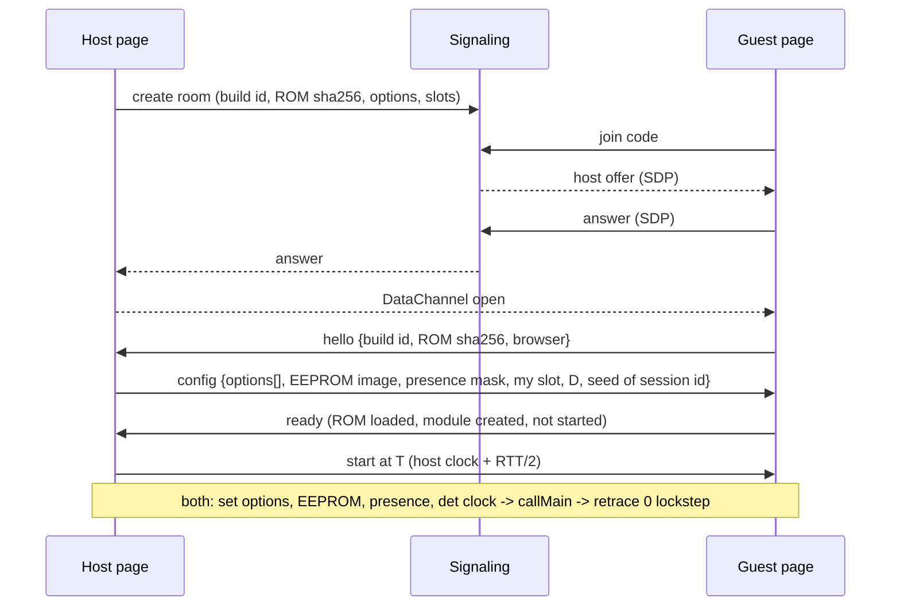
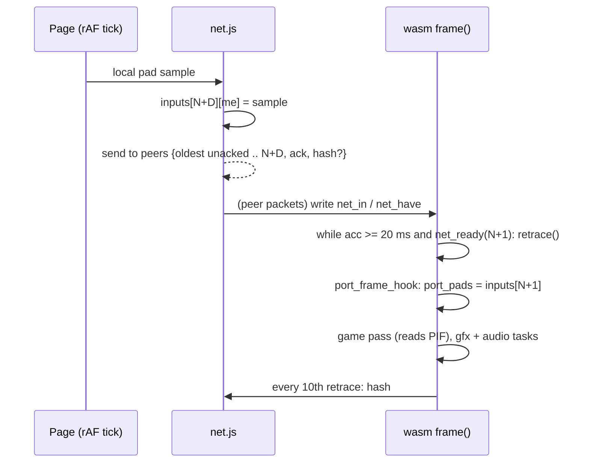

# Online multiplayer for the Conker EU web port: design (P336)

Status: design for review. Nothing is implemented. Diagram: `online_multiplayer_architecture.svg` (same folder).
Evidence comes from branch port-web at the P334 head (2026-10-27). Citations are file:line or function names.

## TL;DR (recommendation)

- **Model: deterministic input lockstep with a small input delay.** Each peer runs the same `conker.wasm` on its own ROM and boots from power-on with the same settings. Peers exchange only controller inputs: 4 bytes per player per 50 Hz retrace. The game is already close to deterministic. Under `?det=2`, recorded routes replay identically (P252, P270), and game time is counted in VI retraces, not wall time (`g_frame_ticks = g_sched_retrace_count`, init_49E0.c:308). Expected input lag is 2 to 4 retraces (40 to 80 ms) on top of the game's own lag. That is acceptable for an N64 split-screen game whose MP modes already run at 15 to 25 game fps.
- **Transport: WebRTC DataChannels** (unordered, `maxRetransmits: 0`), with every packet repeating all unacknowledged inputs. Peers form a **full mesh** (at most 6 links for 4 players), and the host relays for any pair that cannot connect. **Signaling for the MVP is copy-paste codes**, so no server is needed. Phase 2 adds room codes through a Netlify Function plus Netlify Blobs (HTTP polling; Netlify Functions cannot hold WebSockets). Public STUN is free. TURN is optional and cheap, because traffic is about 6 KB/s per link.
- **Rollback (GGPO-style) is not in the MVP.** It is feasible in principle: the whole machine is wasm linear memory, roughly 10 to 12 MB of real game state per snapshot. But the renderer and audio run inside the retrace, and resimulation cost has not been measured. It is a Phase 4 option, gated on Phase 0 measurements. **Host video streaming is ruled out:** guests would play without a ROM, it adds 100 ms or more of latency, and it needs megabits of upload per guest.
- **Session start:** every peer reboots into an "online" boot. The host dictates the build id, ROM SHA-256 (the hash only), options, the EEPROM image (2 KB of user save data, not ROM data) and the controller presence mask. From retrace 0, all peers run in lockstep. Player 1 drives the title and MP menus as on the N64, and the other players join at character select.
- **Optional and off by default**, per the feature rule. The feature lives in an "Online" panel. Without it, the page and the game behave exactly as today.
- **Effort:** MVP for 2 players with copy-paste signaling is about 5 to 6 sessions (Phase 0 + 1). Room codes, 4 players and robustness add 2 to 3 more. The "my view only" crop adds 1 to 2. Rollback would be 4 to 6 more.

---

## 1. Determinism audit

The question: given the same wasm, the same ROM and the same inputs per retrace, do two browsers produce bit-identical game state at every retrace?

**Good news from the architecture**
- The game is single-threaded C in wasm. Its N64 threads are Emscripten fibers on one JS thread (`emscripten_fiber_swap`, pc_sched.c `port_sched_run`), and there are no pthreads. Wasm integer arithmetic and f32/f64 arithmetic are IEEE-deterministic across engines. The build uses no `-ffast-math` and no SIMD (port/Makefile:9-22).
- libm is compiled into the wasm. The only `Math.*` calls in `conker.js` are runtime helpers (`Math.max/min/round/floor/ceil/clz32`), not game math. The 64 wasm imports are GL calls, `emscripten_get_now`, fibers, main-loop, fd and `run_script` (port_flag) (checked in the built conker.js).
- Game time is retrace-counted. `game_update_frame_timing` (game_45B80.c, was func_15019F20) derives the step from `g_frame_ticks`, which init_49E0.c:308 sets from `g_sched_retrace_count`. Slow motion, the dt history and `g_frame_count` all follow from it. The PIF read happens inside the retrace. Timers fire only at retrace (`port_vi_retrace` → `timers_poll`, pc_os.c).
- The RNG is a 64-bit LFSR in `g_random_seed` (game_DAE50.c `random_int`/`random_seed`). It is seeded with a constant (`random_seed(0x81280783)` when `g_game_mode == 2`, conker/src_eu/game/entrypoint.c:76), otherwise from its BSS value, and it lives in game memory.

**Nondeterminism sources, and how to pin each**

| # | Source | Evidence | Pin |
|---|---|---|---|
| 1 | Wall clock in `osGetTime/osGetCount` | pc_os.c `raw_time()` = `performance.now()` unless `det_mode`. Game code mixes `osGetCount()` into randomness: game_36680.c:586-594, game_357F0.c:38-70, game_3DF10.c:196-241, game_40490.c:990 | Force the det clock online. `det_now()` = retrace × 1/50 s + 1000 ticks per read (pc_os.c:381). This is deterministic as long as the sequence of reads is, and it is: reads come only from game code and `timers_poll` at fixed points |
| 2 | Scheduler wall-time budget | pc_sched.c:184: a frame returns to the browser after 40 ms (`FRAME_BUDGET_MS`), so how far the game threads got depends on CPU speed | Off under det (`!det` test at :184). Force it online |
| 3 | Audio-driven timing | `AI_LEN` (pc_os.c `__port_io_read` 0xA4500004 → `aud_out_ai_len`) reads the Web Audio ring fill, which the browser's audio callback drains | Under det, the virtual AI queue drains by retrace count (aud_out.c:139-162 `det_vq`). Force it online. The real ring only plays sound |
| 4 | Frame pacing / catch-up / frame drops | pc_sched.c `frame()`: 0 to 4 retraces per rAF tick, and a backlog above 2 periods is dropped | Harmless. Each retrace is a complete, input-indexed unit, and dropping wall time does not drop retraces. Online, the barrier `net_ready(N+1)` gates each retrace (§4). Keep det=2's wall-paced VI, not det=1's "one per tick" |
| 5 | Input sampling time | main.js `pollInput()` writes `port_pads` in wasm memory every animation frame, asynchronously (pc_pif.c:12-14, 33) | Online, the page never writes `port_pads`. `port_frame_hook` (pc_sched.c:380) copies `inputs[N][ch]` at the start of retrace N. `?padf` already proves frame-indexed input replays (pc_pif.c:40-84) |
| 6 | Tab hidden / pause | main.js:593 `visibilitychange` → `port_set_paused` stops frames (pc_sched.c `frame()`; pc_os.c `now_ms`) | Not a determinism bug, since stopped frames run no retraces, but it stalls the session. Online: broadcast "paused", or keep running on a `setTimeout` loop (a tab playing audio is throttled less). Never pause silently |
| 7 | Controller presence | `controller_init_all` (game_33660.c:35, was func_15006234) runs `osContInit` once at boot. That sets `g_cont_connected_mask`/`g_cont_count`, and pc_pif.c `osContInit` reports channel i present iff `port_pads[i][0]` | The host fixes a presence mask before `callMain`. It is identical on all peers and has one bit per human (others absent, or bots chosen in the game menu) |
| 8 | Options that change game code | port_options.h: skip intro, HUD always on, longer breath, longer tail spin, no drunk FX, full LOD, air bar, swim invert, rumble (changes PIF replies and `os_motor_init`), crosshair (spawns HUD objects), volume sliders (change sequencer state) | Host dictates the whole `port_options[]` vector. Local volume moves to a page-side master gain. Page-only input options (toggle crouch/walk/R-look, main.js:317-324) stay local: they change the input sent, not the game |
| 9 | URL test flags | `port_flag()` (pc_os.c:27-40): `?padf`, `?p205goto`, `?p240steer`, `?mallocpad`, `?warp`... | Online boot ignores them, except a whitelisted test set that is part of the session hash |
| 10 | Save data | EEPROM 2 KB loaded from IndexedDB before `callMain` (main.js:692-694, pc_pif.c:105-111). MP unlocks and settings may live there | Host sends its EEPROM image (user data, not ROM data), or every peer uses a blank one. Online EEPROM writes go to a sandbox (no `portEepDirty` persist) |
| 11 | GPU-dependent bytes in game memory | Renderer writes `glReadPixels` results back into RDRAM: offscreen shadow pass `off_writeback` (gfx_f3dex2.c:829-850, P137) and pause-screen frame `fbc_check_timg` (:975-1000, P161) | They only feed later RDP texture reads, not CPU logic (to be confirmed by a write-watch in Phase 0). Exclude these ranges from the desync hash (renderer exports them). Keep camera_read_depth_row's z-row un-written online (P335 note, gfx_f3dex2.c:902); a future z readback must never be enabled online |
| 12 | Uninitialised memory / heap layout | Fresh wasm memory is zero. Game threads run on their own fiber stacks (pc_sched.c:219 `aligned_alloc(C_STACK/A_STACK)`), so stack garbage comes only from game code. The game allocates from its own heap inside the RDRAM mirror (MEMORY.md "Heap and allocator regions") | Deterministic as long as JS does not `malloc` between boot and game-thread creation in a different way. Rule: no page-side `_malloc` during a session (ROM `_malloc` happens before boot on all peers) |
| 13 | Floats | Wasm f32/f64 are deterministic, apart from NaN sign/payload bits, which engines may produce differently | Only a problem if game code inspects NaN bits as integers. Phase 0's cross-browser hash test (Chrome vs Firefox vs Safari) settles it |
| 14 | Different builds / ROMs | — | Session refuses to start unless sha256(conker.wasm) and the normalised sha256(ROM) match |

**Conclusion:** det=2 already pins 1 to 4. Online mode = det=2 + frame-indexed inputs for 4 channels + a synced boot configuration (7 to 10) + the hash exclusions in 11. Risks 12 and 13 are low and are tested explicitly in Phase 0. Cross-browser determinism has **not** been shown yet: P252/P270 replayed routes in Chrome only.

## 2. Netcode models

| | (a) Input lockstep + delay | (b) Rollback (GGPO-style) | (c) Host-authoritative streaming |
|---|---|---|---|
| What crosses the net | inputs (about 4 B/player/retrace) + hashes | the same | host: video + audio stream; guests: inputs |
| Felt latency | D × 20 ms (D = 2 to 4) for everyone, symmetric | about 0 local; remote players' actions corrected up to RTT/2 late | host 0; guests RTT + encode/decode (100 to 200 ms) |
| Needs determinism | yes (desync = session ends) | yes, plus save/restore | no |
| CPU cost | none extra | save every retrace + resimulate up to RTT/20 ms retraces per tick | host encodes video; guests decode |
| Bandwidth | about 2 to 6 KB/s per link | the same | 2 to 5 Mbit/s per guest, host upload × 3 |
| ROM rule | each player owns and loads a ROM | the same | **broken**: guests play without a ROM; game pictures and audio streamed |
| Work | small: barrier + input ring + signaling | large (see below) | medium (`canvas.captureStream` + MediaStream), but against the project rule |

**(b) Rollback, in detail.** *Snapshot size.* Static data+bss+stack end at `__stack_pointer` = 0x113F96D0, about 19 MB above `GLOBAL_BASE` = 256 MB (parsed from conker.wasm). That region contains the 8 MB `n64_rdram` mirror, the 64 KB `n64_seg16`, game C globals, the port's PIF/timer/scheduler state, plus things that must **not** be restored: the audio ring (aud_out.c:21, 512 KB, read by the ScriptProcessor), renderer statics (≥ 5 MB of `glReadPixels` scratch at gfx_f3dex2.c:829/975, plus texture-cache tables that mirror GL objects living in JS) and test-aid buffers. On the heap are the 64 MB ROM copy (excluded) and fiber stacks (256 + 128 KB per thread). The real game state is about 10 to 12 MB.

*Cost.* A 12 MB copy takes about 1 to 3 ms on desktop and 3 to 8 ms on phones. A ring of 8 snapshots takes about 100 MB. Delta/dirty-page snapshots would be smaller, but wasm has no write barrier, so finding dirty pages needs a compare pass of the same cost.

*Resimulation.* A retrace contains the whole game pass, including display-list building (CPU), the gfx task (`osSpTaskStartGo` → `gfx_run_task`, WebGL, pc_os.c) and the audio task (`aud_run_alist`). During resimulation the gfx task must be skipped (post SP/DP events without drawing), and audio output must be discarded while its state is kept. The per-retrace CPU time with 4 players has not been measured. At an assumed 3 to 8 ms without rendering, a 100 ms RTT means rolling back about 3 retraces, so 10 to 25 ms of work in a 20 ms tick. That is fine on desktop and marginal on phones.

*Hard parts.* Restoring memory is only safe between retraces, when every fiber is suspended (it is: `frame()` runs on the scheduler context). The asyncify/fiber bookkeeping in JS is append-only, so it is fine. The renderer's C caches must be excluded or invalidated, or they will point at stale GL objects. A wrong snapshot region list shows up as rare, hard-to-debug desyncs.

**Recommendation:** (a) now. The game itself has 2 to 3 retraces of pipeline lag and MP runs at a low game fps, so 2 to 4 retraces of input delay is in the range players accept for N64 netplay (it is how emulator netplay, e.g. Mupen64Plus netplay / RetroArch "delay frames", is commonly played). Keep (b) as Phase 4, only if Phase 0 measures `retrace` without rendering at ≤ 4 ms on mid hardware and players ask for it.

## 3. Transport, signaling, topology

**DataChannel settings:** one channel per pair, `{ordered: false, maxRetransmits: 0}`. Packet layout (binary, about 40 to 60 B):

`type | first_frame u32 | count u8 | ack_frame u32 | inputs[count] (buttons u16, x s8, y s8) | [hash_frame u32, hash u32]`

Each packet carries every input from the oldest unacknowledged frame to N+D (up to K = 32). One lost packet therefore costs nothing, and only a burst longer than D stalls. A reliable ordered channel (`ordered: true`, the default) is simpler, but head-of-line blocking makes one lost packet stall for a full RTT. Use it only for control messages (lobby, config, pause, disconnect, desync report), on a second channel.

**WebSocket relay instead of WebRTC?** It works everywhere, with no NAT issues, but every input pays client→server→client and TCP head-of-line blocking. It is fine as a fallback transport behind the same `net.js` interface. It needs a real WebSocket host (not Netlify).

**Signaling options (the static Netlify site cannot hold a WebSocket):**

| Option | Infra | UX | Notes |
|---|---|---|---|
| Copy-paste codes | none | host sends a code, guest pastes and returns an answer code (chat/Discord) | Non-trickle ICE (wait for gathering), SDP compressed to about 300 to 600 base64 chars. Fine for 2; for 4 use a star (3 exchanges) and let the host forward the mesh offers over its channels |
| **Netlify Function + Netlify Blobs** | stays on Netlify; free tier | 4 to 6 letter room code | HTTP POST offer/answer under `room/<code>/<slot>`, guests poll every 1 s for a few seconds. No WebSocket needed. Rooms expire after 10 min |
| Cloudflare Worker + Durable Object | a CF account (free tier) | room code, instant | Real WebSocket; also a ready relay fallback |
| Public brokers (PeerJS cloud, MQTT, Nostr) | third party | room code | Depends on someone else's uptime and privacy |

**NAT traversal:** STUN via `stun.l.google.com:19302` and `stun.cloudflare.com:3478` (free). This works for most home NATs. Symmetric NAT and mobile CGNAT (roughly 10 to 20 % of pairs) need TURN. Options: a free tier of a hosted TURN (Cloudflare Realtime TURN, metered.ca; check current limits), or coturn on a small VPS. Traffic is tiny: about 6 KB/s per link, about 20 MB per player-hour, so cost is negligible. Short-lived TURN credentials can be minted by a Netlify Function (HMAC of a secret kept in Netlify env vars).

**Topology:** for 2 to 4 peers, use a **mesh**: each peer sends its own input to every other peer, and latency is that of the worst pair. Fallback: if a pair fails ICE, the host relays that pair's inputs (+1 hop for that pair only). A pure star (all through the host) is simpler to signal but adds a hop for every guest-to-guest pair. Use it only if copy-paste signaling is used for 3 to 4 players.

## 4. Integration points in the port

**New C (port side only; game C unchanged):**
- `port/ultra/pc_net.c`: an input ring `net_in[256][4]` (frame mod 256) plus `net_have[256]` bitmasks in wasm memory, filled by JS. It exports `port_net_ptr()`, `port_net_enable(mask_present, local_ch, delay)` and `port_net_frame()` (the last retrace run).
- **Frame barrier:** pc_sched.c `frame()` changes from `while (acc >= per && n < VI_MAX_STEPS)` to `... && (!net_on || net_ready(port_frame_count + 1))`. If inputs are missing, the accumulator is clamped and nothing runs, so the game just pauses for that tick. `port_video_frame` still presents the last frame. The peer with the larger frame advantage nudges its `per` up by 1 % (GGPO-style time sync) so stalls stay rare.
- **Input application:** `port_frame_hook` (pc_sched.c:51, :380) = `net_apply()`. It copies `net_in[N][ch]` into `port_pads[ch][1..3]` for every present channel, before `port_vi_retrace`/`port_sched_run`. Then the game's `cont_read_frame` → `osContStartReadData` → `pif_run` (pc_pif.c:250-265) delivers it unchanged. `padf_apply()` must not run online.
- **Forced determinism:** `port_flag("det")` is read lazily in 4 places (pc_os.c:390, pc_sched.c:179, :406, aud_out.c:152). Add `port_net_force_det()`, set before `callMain`, so those read 2 when online.
- **Session config before boot:** the options vector via `port_set_option` (existing), the EEPROM via `port_eeprom_ptr` (existing), presence via `port_pads[i][0]` (existing), and the sandboxed EEPROM via a flag that suppresses `__port_eep_dirty`.
- **Start point:** MVP = power-on in lockstep, with "Skip intro" forced on so the title appears quickly. Player 1 navigates to Multi → mode → characters, and the other players press A at character select, exactly as on an N64. Later: an `?warp`-style direct start into an MP mode (`g_level_start_session_mode`, `g_level_start_player_mask`, `g_level_load_id`, game/entrypoint.c:79). This needs mapping the MP menu's writes and is not in the MVP.
- **Desync detection:** `port_net_hash()` every 10 retraces, hashing `g_random_seed`, `g_frame_count`, then xxHash32 over `n64_rdram` in 64 KB blocks (minus renderer-written ranges), `n64_seg16`, and the port's PIF/timer state. Cost is about 1 ms per 8 MB. Hashes travel in the input packets. On a mismatch, both peers exchange their 128 block hashes, report frame + blocks + addresses (names via symbols.tsv), and end the session.
- **Pause:** the in-game pause (START) is just input, so it is deterministic and free. A page pause or hidden tab sends a control message "P2 paused", and every peer shows an overlay while the barrier stalls naturally.
- **Disconnect:** after 10 s without packets, the remaining peers agree on the last frame F they hold for the lost player (max of what anyone has, forwarded). From F+1 that channel gets neutral input, and the session continues, or the host ends it (host's choice in the lobby). A lost host ends the session in the MVP.
- **Local view (optional, presentation only):** split-screen layouts are fixed per player count (2 players: top/bottom; 3 to 4: quadrants). The renderer can blit the local player's viewport rectangle to the full canvas in `port_video_frame` (`glBlitFramebuffer` is already imported). Letterbox it to keep its aspect, or stretch it (a toggle). This changes nothing in game state, so it is safe. Making the game *draw* only one view is **not** safe, because rendering code also does LOD and visibility, which feed game logic.

## 5. Options and feature rules

- The new **"Online" panel** in the page (next to Options) is hidden behind an Options toggle "Online multiplayer (experimental)", default **off**. With it off, `net.js` is not even loaded, and `frame()`/`port_frame_hook` take today's path (`net_on == 0`). This is testable by conker.wasm md5 plus the existing holdl/warp regressions.
- In a session, the host's Options panel values are applied and the guests' panels are greyed out. Local-only settings remain: key/pad bindings, toggle latches, master volume (a new page gain node instead of the game sliders), and "my view only".
- One commit per feature, per the project rule: (1) det force + net ring + barrier (C), (2) net.js + copy-paste signaling + Online panel, (3) desync hash, (4) room codes, (5) view crop, and so on.

## 6. Risks, open questions, effort, tests

**Risks**
1. **Cross-browser float/NaN differences** (low). Caught by Phase 0 hash trails; if found, fix the specific game function.
2. **Hidden state outside the hashed regions** that diverges, e.g. a port-side cache used by game logic. Phase 0 compares *all* non-excluded memory between two runs to find it.
3. **The game's own MP menu flow differs with remote players** (e.g. it expects the controller to be present at boot). That is handled by the presence mask. The "Press A to join" flow is the same as a local pad.
4. **Background-tab throttling** stalls everyone. Mitigated by the overlay and the setTimeout loop; worst case, a paused session.
5. **Browser performance gap:** lockstep runs at the speed of the slowest peer. A phone that cannot hold 50 Hz in 4-player split screen slows the whole session.
6. **Audio during stalls:** the ring underruns into short silences (no crackle, since the ring drops cleanly). Acceptable.
7. **Unconverted or stubbed MP code paths** (e.g. P224's MP stubs, now all C) may hide port bugs that are themselves nondeterministic, such as reads of uninitialised null-zone memory. Phase 0 surfaces them as divergences.

**Decisions (user, 2026-10-27)**
1. Input delay of 40 to 80 ms is acceptable. Lockstep it is; rollback stays optional.
2. Copy-paste connection codes for the first version.
3. No TURN: accept that some pairs cannot connect.
4. Power-on lockstep, Player 1 drives the menus.
5. The session uses the host's EEPROM (unlocks shared).
6. A disconnected player stays in the game standing still (neutral input); the session continues.
7. "My view only" is an option (Online panel), not forced.
8. Spectators: not now.

**Open questions for the user** (answered above)
1. Is input delay (40 to 80 ms) acceptable for the MVP, with rollback only later or never?
2. Signaling: is copy-paste codes OK for the first version? For room codes, Netlify Functions + Blobs (stays on Netlify) or a Cloudflare Worker (instant, real WebSocket, a second account)?
3. TURN: pay or self-host one, or accept that roughly 10 to 20 % of pairs cannot connect (they could fall back to the host relay only if the host itself is reachable)?
4. Session start: power-on lockstep (Player 1 drives the menus, about 10 s of title) or a direct MP warp later?
5. Save data: should the session use the host's EEPROM (unlocks shared) or a blank save?
6. Disconnect policy: end the session, or continue with the lost player idle or as a bot?
7. Is "my view only" (crop) wanted for 2-player top/bottom, given its very wide aspect?
8. Should spectators (read-only peers receiving inputs) be in scope? They are cheap with lockstep.

**Effort (sessions of about 150 tool calls)**

| Phase | Content | Sessions |
|---|---|---|
| 0 | Determinism harness: `?padf` for channels 0 to 3; `port_net_hash` + per-retrace hash log; two runs in one Chrome, Chrome vs Firefox/Safari; node dual-instance test; write-watch on renderer writebacks; measure retrace ms with and without rendering (rollback gate); snapshot-size measurement | 1 to 2 |
| 1 (MVP) | pc_net.c ring + barrier + forced det + presence/options/EEPROM sync; net.js with WebRTC mesh for 2 players; copy-paste signaling; Online panel; desync report | 3 to 4 |
| 2 | Room codes (Netlify Function + Blobs), 3 to 4 players, host relay fallback, TURN credentials, adaptive D + time sync, disconnect handling, stall overlay | 2 to 3 |
| 3 | "My view only" crop; MP direct-start warp; spectators | 1 to 2 |
| 4 (optional) | Rollback: region registry, renderer/audio suppression in resimulation, snapshot ring | 4 to 6 |
| — | Reconnect/late join by deterministic fast-forward of the input log from retrace 0 (no state transfer) | 2 |

**Test strategy**
- **Offline determinism first:** one browser, the same 4-channel `?padf` MP script run twice, gives identical per-retrace hash logs. Then the same script in Chrome and Firefox (and Safari if available) gives identical logs. Then a node run (`PORT_DET`, node_run.js) gives the same.
- **Two peers on one machine:** one headless Chrome (muted, `--mute-audio`, `?mute=1`, one Chrome at a time per the project rules) with **two tabs** connected over WebRTC on localhost (host candidates, no STUN). Each tab gets its own channel's `?padf`. Pass criteria: hash trails identical between the tabs and identical to the offline 4-channel run of the merged script.
- **Network emulation in-page:** a `net.js` shim with `?netsim=lat:80,jit:20,loss:5` delays, reorders and drops DataChannel messages (no root-level tc/dnctl needed). Check that there are no desyncs, that stalls stay below a threshold at D = 3 with 80 ms latency, and that disconnect handling works.
- **CI-friendly:** a node test with two module instances in one process exchanging inputs through an in-memory lossy queue. It runs fast with no browser.
- **Regression:** with the feature off, conker.wasm behaviour is unchanged (holdl.sh, warp.sh), and check.sh is GREEN.
