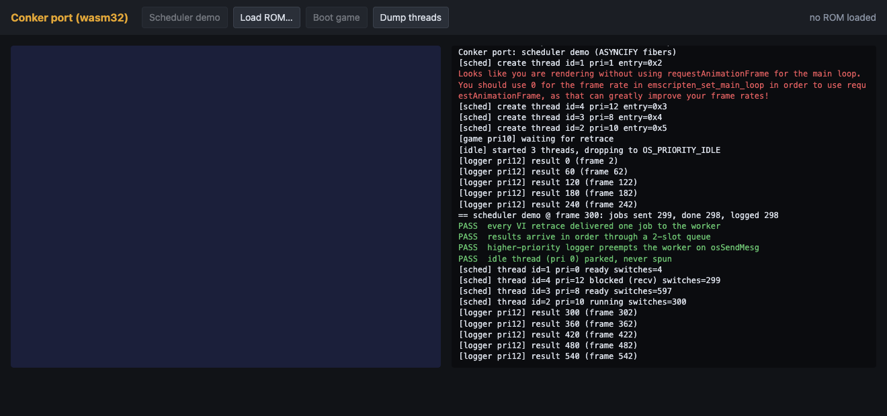

# Session P3: browser skeleton (branch `port-web`, 2026-10-21)

Goal: de-risk the platform layer for the wasm32 port while Phase 1 converts asm to C elsewhere.
Everything lives under `port/`. No game `.c` file, shared header or shared build file was changed,
so the matching N64 build is unaffected.



## What exists now

| path | what |
|---|---|
| `port/web/Dockerfile` | toolchain image `conker-emsdk`: `emscripten/emsdk:4.0.15-arm64` (pinned; `--build-arg EMSDK_TAG=4.0.15` on x86), system libs pre-warmed |
| `port/web/run.sh` | `image`, `build [targets]`, `census`, `serve [port]` / `stop` (python http.server in the container, `127.0.0.1:8064`), `sh` |
| `port/Makefile` | `demo`, `objs` (census), `game`, `web`, `clean`. Output in `port/build/web/` |
| `port/tools/census.py` | compiles all 719 `conker/src_eu/**/*.c` with emcc twice (strict clang defaults, then the port flags) → `port/build/obj/*.o` + `port/build/census/{summary.txt,files.tsv,diag/}` |
| `port/tools/gen_stubs.py` + `wasmobj.py` | reads the wasm objects' symbol tables and generates `port/stubs/asm_stubs.c` (weak function stubs with the **exact wasm signature used at the call sites**, log name once, return 0) and `port/stubs/data_stubs.c` (zeroed arrays sized from the N64 address gap to the next symbol), plus `stubs_report.txt`. Generated, gitignored |
| `port/exclude.txt` | TUs that compile but must stay out of the link (1 today) |
| `port/ultra/` | PC libultra: `pc_sched.c` (fiber scheduler, threads, message queues, events, main loop), `pc_os.c` (VI, PI-from-ROM, timers, SP/DP/AI no-ops, caches/TLB/interrupt no-ops, controllers, stub logging), `pc_video.c` (WebGL2 clear), `port_prefix.h` (force-included into every game TU; `#pragma weak` on every replaced libultra entry point) |
| `port/sched_demo/demo.c` | 3 threads + idle thread, 3 queues, fake VI; self-checks at frame 300 |
| `port/boot/game_main.c` | PC entry for the game: `port_boot` (= `func_10001050` without the bss clear) + a PC `func_10001194` (main thread) |
| `port/web/index.html`, `main.js` | canvas, ROM picker (z64/v64/n64 normalised, SHA-1 checked, cached in IndexedDB, never uploaded), console panel, "Dump threads" |
| `port/tools/node_run.js` | headless smoke test in node (`print` to stdout) |
| `port/tools/bootpath.py` | BFS over `jal`/calls from boot roots: which asm-only functions block boot |
| `port/tools/kindclash.py`, `size_probe.sh` | symbol used as data in one TU and function in another; ASYNCIFY size probe |

## Build and run

```sh
cd ~/conker-wt/web
port/web/run.sh image            # once (pulls emscripten/emsdk:4.0.15-arm64)
port/web/run.sh build            # ~50 s from clean: census + demo + game + page
port/web/run.sh serve            # http://localhost:8064/   (port/web/run.sh stop)
#   ?app=demo           autostarts the scheduler demo
#   ?app=game           autostarts the game if a ROM is cached in IndexedDB (else: Load ROM…, Boot game)
#   &timer=1            drive frames by setTimeout instead of rAF (headless Chrome virtual time)
docker run --rm -v $PWD:/src -w /src conker-emsdk node port/tools/node_run.js \
    port/build/web/conker.js createConker 4 baserom.eu.z64      # headless game run
```

Screenshot (host Chrome, throwaway profile in the scratchpad):
`"/Applications/Google Chrome.app/Contents/MacOS/Google Chrome" --headless=new --user-data-dir=<tmp> --use-angle=swiftshader --enable-unsafe-swiftshader --virtual-time-budget=9000 --window-size=1320,620 --screenshot=out.png 'http://localhost:8064/index.html?app=demo&timer=1'`

## clang / wasm32 compile census (719 TUs, `NON_MATCHING` defined)

Flags: `emcc -O1 -std=gnu89 -nostdinc -fno-builtin -fno-strict-aliasing -fwrapv -fsigned-char`, the
game's include dirs and defines plus `-D_MIPS_SZLONG=32 -D_MIPS_SZINT=32 -DPORT`.

| mode | TUs with errors | errors |
|---|---|---|
| strict (clang defaults) | 176 | 718 |
| port flags (`-Wno-error=` int-conversion, incompatible-pointer-types, implicit-int, implicit-function-declaration, return-type) | **7** | 27 |

Strict-mode errors are almost all type laxity that IDO accepts: 494 int↔pointer conversions
(`int-conversion`), 286 incompatible pointer types, 5 `return;` in non-void functions, 3 function-pointer
type mismatches. They become warnings with the port flags (439 int-conversion in 134 TUs,
313 incompatible-pointer-types in 109 TUs, 70 K&R/`deprecated-non-prototype` in 36 TUs,
26 missing-return in 22 TUs, 4 array-bounds). None of these needs a source change to build, but
the int↔pointer ones are where 64-bit native builds will break (PLAN 3.9).

Not found: inline asm (0), unknown-pragma problems (`GLOBAL_ASM` ×1891, `#pragma intrinsic`,
`#pragma function sqrtf` are silently ignored), header/size/alignment assumptions (the PR headers
work as-is with `_MIPS_SZLONG=32`; wasm32 `long`/pointers are 32-bit). One header clash for the
PC layer only: the PR headers' `size_t` is `unsigned int`, the emscripten libc's is
`unsigned long` (same width) — `port/ultra/pc_ultra.h` defines `_SIZE_T` first, and the PC layer
must not put `include/2.0L/PR` on its include path (`PR/sched.h` shadows libc `<sched.h>`).

The 7 TUs that still fail (left out of the link; their functions get stubs):

| TU | IDO-ism |
|---|---|
| `game_2062D0.c` (15 errors), `game_36680.c` | array initialised from another array/global: `u8 tmp[3] = D_800AB340;` |
| `debugger_257350.c`, `init_2070.c` | `s - fmt` between `const unsigned char *` and `const char *` (`_Printf`) |
| `game_A28B0.c` | lvalue cast `((u8 *)p->unk218) += 1;` |
| `game_eu_1D1150.c`, `game_eu_B37F0.c` | call with more/fewer args than the K&R definition earlier in the same TU |

Link-level findings (more important than the compile errors):

- **262 functions are called with a wasm signature that differs from their definition** (282
  wasm-ld warnings; `port/build/link_warnings.txt`). Causes: implicit `int f()` declarations
  calling `void` functions, local prototypes that disagree with `functions.h`, `f32` vs `s32`
  parameters (`func_1001CF38`). wasm traps on these calls (`unreachable`), so each is a runtime
  crash waiting to happen. 17 of the stubbed functions are even imported with conflicting
  signatures by different TUs. Fix: one prototype per function in `functions.h`, used everywhere
  (a lint for Phase 1).
- **Function declared as data**: `game_eu_12A7C0.c` has `extern s32 func_1000EC24;` to take its
  address → wasm-ld "symbol type mismatch". The only case; listed in `port/exclude.txt`.
- **46 data symbols are absolute values below 0x80000000** used as `&sym` (ROM offsets, segment
  addresses like `D_10029400`, `D_160036F3`). In wasm they become arrays, so `&sym` is wrong.
  They need real constants (Phase 2b).
- Stubs: **537 function stubs** (510 asm-only, 20 absolute-address-only, 7 missing/excluded) — only
  the asm functions *referenced from C* need one; 1882 functions are asm-only in total. **1635 data
  stubs** (1.5 MB zeroed): the N64 `.data`/`.rodata` blobs are not in the build yet.
- ASYNCIFY cost on all game code (`--export-all`, no GC, `size_probe.sh`): 1,129,539 bytes with
  ASYNCIFY vs 607,402 without = **1.86×**, before any `ASYNCIFY_ONLY` list.

## Scheduler design (`port/ultra/pc_sched.c`)

- `osCreateThread` gives the `OSThread` a fiber (`emscripten_fiber_init`, 256 KB C stack + 128 KB
  asyncify stack, both malloc'd; the game's N64 stack pointer is ignored). Up to 32 threads, found by
  `OSThread *` in a side table. `OSThread.priority/state/id` are kept in sync for game code that reads them.
- The browser main context is the scheduler fiber
  (`emscripten_fiber_init_from_current_context` in `port_run`). `emscripten_set_main_loop(frame, 0, 0)`
  (rAF; `?timer=1` → setTimeout) runs: timers → VI retrace message (`osViSetEvent`, every
  `retraceCount` frames) → `OS_EVENT_VI` → `port_sched_run()` → WebGL2 clear.
- `port_sched_run` repeatedly swaps to the highest-priority READY thread (FIFO among equals) until none
  is ready, then returns to the browser. A thread leaves the CPU only inside libultra calls:
  `osRecvMesg` on an empty queue, `osSendMesg`/`osJamMesg` on a full one, `osStopThread`,
  `osDestroyThread`, `osYieldThread`, or when it makes a higher-priority thread ready
  (`osSendMesg`, `osStartThread`, `osSetThreadPri`) — libultra's preemption points.
- Priority 0 is never scheduled: the game's idle thread (`func_100010F8`) lowers itself to 0 and
  spins in `do {} while (1)`; here it parks forever. Verified in the demo (`idle_spins == 0`).
- A thread function that returns is destroyed (its stacks freed by the scheduler after the swap).
- Blocking from outside a thread (`cur == NULL`, e.g. during `boot()`) logs and returns -1.
- Events: `osSetEventMesg` table; `port_post_event()` delivers. `osSpTaskStartGo` posts SP (and DP
  for GFX tasks) at once; `osPiStartDma` copies from the ROM buffer and replies at once;
  `osContStartReadData` replies at once with no buttons.
- Demo result (Chrome and node): 4/4 PASS — one job per VI retrace, ordered delivery through a full
  2-slot queue, the pri-12 logger preempts the pri-8 worker inside `osSendMesg`, idle never spins.
- Known limits: no preemption (a thread that busy-waits on a flag or `osGetCount` without a libultra
  call hangs the tab: make those loops yield); one frame = one retrace at the display's rate (PAL is
  50 Hz: pace later); `MAX_SWITCHES_PER_FRAME` 200k guard; `osSetTimer` is polled per frame only.
- The libultra functions decompiled into game TUs (e.g. `osStartThread` in `init_eu_22D70.c`) are
  made weak by `port_prefix.h`, so the PC versions win without editing game files. Their internal
  helpers (`__osEnqueueAndYield`, …) are stubs and must never be called.

## The real entry point: how far it gets

N64: `func_10001000` (asm entrypoint) → `func_10001050` → thread 1 `func_100010F8` (creates the
queues via `func_10004470`, the main thread `func_10001194` at pri 10, then idles) →
`func_10001194` → … → `func_15007830` (game entrypoint, `game/entrypoint.c`).

PC (`port/boot/game_main.c`): `port_boot` sets the IPL3 globals (`osCicId` `D_80000310 = 0x17D9`,
which gates the main-thread start; `osMemSize`; `osResetType`), calls `func_100061F8(1,31)` and
`__osInitialize_common`, and starts thread 1 — the real C `func_100010F8`. `func_10001194` is
asm-only, so the PC provides it, following the commented draft in `init_1050.c` (no rzip/TLB, no
game-data DMA). Headless run with the EU ROM:

```
[rom] 67108864 bytes, header "CONKER BFD          "
[boot] func_100061F8(1, 31)
[stub  1] func_100061F8 (asm:init_eu_5DA0.c) thread=-1 frame=0
[sched] create thread id=1 pri=5           <- real func_100010F8 runs, creates queues
[sched] create thread id=3 pri=10          <- main thread
[boot] main thread: func_10001194 (PC version)
[sched] create thread id=21 pri=250       <- real func_10005218 (C) creates it (entry func_100052A0)
[stub  2] func_100052A0 (asm:init_50A0.c) thread=21
[stub  3] func_1000709C (missing)         <- prototyped in functions.h, defined nowhere
[stub  4] func_10003C6C (asm:init_3C40.c)   x2: framebuffer allocation -> 0
[stub  6] func_10005B04 (asm:init_eu_5DA0.c)
[stub  7] func_10001420 (asm:init_1420.c)
[stub  8] func_10005BE0 (asm:init_eu_5DA0.c)
[stub  9] func_15007830 (asm:game/entrypoint.c)   <- the game proper starts here: asm
[sched] thread 3 returned; destroyed
```

So boot reaches the game entry point in the first frame, and stops there: every function on the
spine after `func_10005218` is still GLOBAL_ASM (only 9 distinct stub hits, not 50, because the
spine ends). `python3 port/tools/bootpath.py --depth 3 func_10001194 func_15007830` lists the
**129 asm-only functions within 3 calls of the boot spine** (403 reachable). That list is the
recommended Phase 1 priority order for getting the browser build past boot.

## Next steps for the browser build

1. Phase 1 priority: the boot path list above (`func_10001194` itself, `func_15007830`,
   `func_10003C6C` allocator, `func_100061F8`, `func_10005B04/5BE0`, `func_10001420`).
2. Add a single-prototype lint (wasm signature mismatches) to `convert.py`/`verify_all` reports:
   262 call sites trap today.
3. Data: initial `.data`/`.rodata` from the ROM (init_data is plain; game_data is rzip) with the
   Phase 2b relocation list; absolute low symbols as real constants.
4. Then Fast3D in `pc_video.c`, audio HLE, input, saves (PLAN 3.3–3.5); `ASYNCIFY_ONLY` list from the
   call graph to `osRecvMesg`/`osSendMesg`/`osYieldThread`/`osStopThread`.
